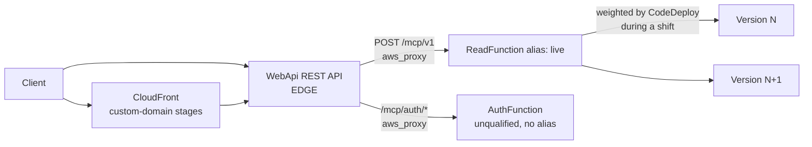

# Design Document

## Overview

This design makes API Gateway invoke the Read Function through its `live` alias, so the CodeDeploy traffic shift and alarm-driven rollback that PROD stages already configure apply to the traffic API callers actually send. The code change is one URI in `template-openapi-spec.yml`. Around it sit one permission removal, a regression test, guidance and documentation updates, and a staged rollout with a one-time rollback drill.

[requirements.md](requirements.md) says what must be true. [PLAN.md](PLAN.md) holds the evidence and the seven locked decisions. This document says exactly what changes in each file, how it is verified, and in what order.

### Design principles

1. **One string changes in the template; everything else follows from it.** No new resource, parameter, condition, or output.
2. **The permission SAM already generates carries the traffic.** The hand-written pair stops being needed, so the redundant half is removed and the unusable half is scheduled for removal.
3. **A test, not a convention, keeps it that way.** The regression guard runs in the existing `read-function` suite, which the main buildspec already gates.
4. **The first real traffic on the new path is `test`, then `beta`, then `prod`.** Each stage is checked before the next is deployed.
5. **Upstream-managed files are not edited.** Local guidance records the deviation instead.

### What is not designed here

Version-scoped alarms, CodeDeploy hooks, dashboard changes, and the upstream report are out of scope (Requirement 10.8). The only follow-up this feature creates is the v0.0.8 removal of `ReadLambdaPermission`, tracked in `TODO.md`.

## Architecture

### Request path after the change



Before the change the `/mcp/v1` arrow went straight to `$LATEST`. The alias was updated by CodeDeploy on every deploy, but nothing invoked it.

### Deploy sequence

The sequence for a stage's first deploy of this change (the migration deploy) and for later deploys differs in one respect. The `RestApi` now depends on the alias through `${ReadLambdaFunctionAliaslive}`, so CloudFormation should finish the alias update, including the CodeDeploy shift, before it updates the `RestApi`. This is my reading of CloudFormation's dependency ordering, not an observed fact; Requirement 9.2 settles it on `test`.

```mermaid
sequenceDiagram
    participant CFN as CloudFormation
    participant CD as CodeDeploy
    participant AG as WebApi (RestApi)
    participant L as Read Function

    Note over CFN,AG: Migration deploy (first deploy of this change)
    CFN->>L: Update function code ($LATEST)
    Note right of AG: API still targets $LATEST: callers get new code at once
    CFN->>CD: Publish version, update alias, start deployment
    CD-->>CFN: Shift finished
    CFN->>AG: Update RestApi body (integration now targets alias)
    Note right of AG: New API Gateway deployment created once

    Note over CFN,AG: Every later deploy
    CFN->>L: Update function code ($LATEST)
    CFN->>CD: Publish version, update alias, start deployment
    Note right of AG: RestApi unchanged; API follows alias, so callers move gradually
    CD-->>CFN: Shift finished (or rolled back on alarm)
```

### Permission model after the change

| Grant | Principal and scope | Target | Status |
|-------|---------------------|--------|--------|
| SAM event permission (`ReadLambdaFunctionMcpV1PostPermission<Stage>`) | `apigateway.amazonaws.com`, `POST /mcp/v1` | Live alias | Carries all Read traffic |
| `ReadLambdaPermission` | `apigateway.amazonaws.com`, `${WebApi}/*` | Unqualified function | Unused; kept one release as the revert safety net, removed in v0.0.8 |
| `ReadLambdaPermissionLive` | `apigateway.amazonaws.com`, `${WebApi}/*` | Live alias | Removed in this change |

Lambda resource policies apply to the exact qualifier they name. A grant on the alias does not cover the unqualified ARN, and the reverse also holds ([Lambda aliases, resource policies](https://docs.aws.amazon.com/lambda/latest/dg/using-aliases.html)). So the migration needs no overlap period: the alias grant that matters already exists in every stage (PLAN section 2, row 12), before the integration moves.

## Components and edits

Each subsection names the file, the exact change, and the requirements it satisfies.

### 1. Integration target (Requirement 1)

File: `application-infrastructure/template-openapi-spec.yml`, the `/mcp/v1` `post` operation (line 48 onward).

Before:

```yaml
      x-amazon-apigateway-integration:
        httpMethod: post
        type: aws_proxy
        uri:
          Fn::Sub: arn:aws:apigateway:${AWS::Region}:lambda:path/2015-03-31/functions/${ReadLambdaFunction.Arn}/invocations
```

After:

```yaml
      x-amazon-apigateway-integration:
        httpMethod: post
        type: aws_proxy
        uri:
          # >! Invoke the Read function through its "live" alias, not the unqualified ARN.
          # >! CodeDeploy shifts the alias gradually in PROD and rolls it back on alarm; the
          # >! unqualified ARN runs $LATEST and would bypass both.
          Fn::Sub: arn:aws:apigateway:${AWS::Region}:lambda:path/2015-03-31/functions/${ReadLambdaFunction.Alias}/invocations
```

Notes:

- `${ReadLambdaFunction.Alias}` is the SAM reference form already used in the Template (`FunctionName: !Ref ReadLambdaFunction.Alias`). SAM rewrites it to `${ReadLambdaFunctionAliaslive}` when it processes the included body, and `Ref` on an `AWS::Lambda::Alias` returns the alias ARN ([AWS::Lambda::Alias](https://docs.aws.amazon.com/AWSCloudFormation/latest/TemplateReference/aws-resource-lambda-alias.html)). Translating the real templates in `PROD` and `TEST` confirmed this (PLAN section 2, rows 4 and 11).
- The comment lines sit between `uri:` and the `Fn::Sub` key, which is valid YAML and keeps the explanation on the line it explains. The `>!` prefix follows the repository's security-comment notation for YAML.
- The three Auth integrations (`/mcp/auth/key/regenerate`, `/mcp/auth/profile`, `/mcp/auth/voucher/redeem`) keep `${AuthLambdaFunction.Arn}`. The Auth Function has no alias, so an `.Alias` reference would not translate.
- The URI is identical for every stage. No `Fn::If`, stage variable, or parameter selects it (Decision 1).

Effect on API Gateway: because the included body changes, SAM computes a new hash for the generated `AWS::ApiGateway::Deployment` once. The URI text is constant afterwards, so later deploys do not redeploy the API.

### 2. Permissions (Requirement 3)

File: `application-infrastructure/template.yml`, the block that starts at the comment "Lambda permissions allowing API Gateway to Execute Read Lambda".

Before (excerpt):

```yaml
  # -- Lambda permissions allowing API Gateway to Execute Read Lambda --

  ReadLambdaPermission:
    Type: "AWS::Lambda::Permission"
    Properties:
      ...

  ReadLambdaPermissionLive:
    Type: "AWS::Lambda::Permission"
    Condition: IsProduction
    Properties:
      ...
```

After:

```yaml
  # -- Lambda permissions allowing API Gateway to Execute Read Lambda --
  #
  # >! The /mcp/v1 integration invokes the "live" alias (see template-openapi-spec.yml).
  # >! SAM generates the permission for that alias from the McpV1Post event, scoped to
  # >! POST /mcp/v1, so no hand-written permission for the alias is needed. This repository
  # >! intentionally departs from the "Permission + PermissionLive" pair described in
  # >! .kiro/steering/atlantis-multi-resource-src.md for the Read function; see
  # >! .kiro/steering/openapi-spec-sync.md.

  # Unused since the integration moved to the alias (spec 0-0-7-api-gateway-live-alias).
  # Kept for one release so the integration URI can be reverted without a window of
  # invocation errors. Remove in v0.0.8 (tracked in TODO.md).
  ReadLambdaPermission:
    Type: "AWS::Lambda::Permission"
    Properties:
      Action: lambda:InvokeFunction
      FunctionName: !Sub "${ReadLambdaFunction}"
      Principal: apigateway.amazonaws.com
      SourceArn: !Sub "arn:aws:execute-api:${AWS::Region}:${AWS::AccountId}:${WebApi}/*"
```

`ReadLambdaPermissionLive` is deleted entirely, including its `IsProduction` condition. `ReadLambdaPermission` is unchanged in its properties (Requirement 3.2).

Why removing `ReadLambdaPermissionLive` is safe in the same update as the URI change: it is a deletion, and CloudFormation performs deletions of removed resources in the cleanup phase after all updates complete. By then the SAM event permission, which is untouched, already allows the alias. Nothing that serves a request depends on the removed grant at any point.

Why `ReadLambdaPermission` stays: reverting the URI in a later deploy re-points the integration at the unqualified ARN. If its permission had been deleted in the same release, the revert would recreate it in the same update that flips the URI, and the two have no dependency between them, so a short window of `500` responses could occur. One release of retention removes that risk.

`TODO.md` change (Requirement 3.4), under the existing `## Future` heading, as the first list item:

```markdown
- [ ] Remove `ReadLambdaPermission` (unqualified grant) from `template.yml` - unused since 0-0-7-api-gateway-live-alias, kept one release for revert safety (v0.0.8)
```

### 3. Regression guard test (Requirement 4)

File: `application-infrastructure/src/lambda/read-function/tests/unit/architecture/openapi-integration-targets.test.js`, beside `no-hardcoded-revisions.test.js` and `instructions-composition.test.js`. The existing `testMatch` (`**/tests/**/*.test.js`) picks it up, and `npm test` in the function directory runs it. The main buildspec runs that for every function directory.

#### Design

The test reads two files that sit outside the function directory, the same way `auth-function/tests/unit/xray-template-config.test.js` reads `template.yml`:

- `application-infrastructure/template-openapi-spec.yml`, parsed with `js-yaml`'s default schema. The file uses the long form (`Fn::Sub: ...`) and no short tags, so no custom schema is needed.
- `application-infrastructure/template.yml`, parsed with a schema that tolerates CloudFormation short tags. The test only needs to know that `ReadLambdaFunction` still declares `AutoPublishAlias`.

Path resolution: from `tests/unit/architecture/`, `application-infrastructure/` is six levels up (`unit`, `tests`, `read-function`, `lambda`, `src`, then `application-infrastructure`), so the test resolves `path.resolve(__dirname, '../../../../../..')` once and joins the two file names onto it. `auth-function`'s test sits one directory shallower, at `tests/unit/`, and uses five `..` for the same reason. I checked that six levels from this directory reach a folder that contains both `template.yml` and `template-openapi-spec.yml`. The implementation should fail with a clear message if either file is missing, so a directory move cannot make the test pass vacuously.

The tag schema does not hand-list tags the way `auth-function`'s test does. `template.yml` uses `!Ref`, `!Sub`, `!If`, `!GetAtt`, `!Equals`, `!Not`, `!FindInMap`, `!Join`, `!Condition`, and `!And`. A new tag in the Template would otherwise break the test with an "unknown tag" error unrelated to its purpose. The helper builds a schema from a tag list, with a type for each of the three YAML kinds (scalar, sequence, mapping), and returns the data unchanged.

Because the fake tags are only there to let the parser through, the test treats every tagged value as opaque and reads only plain keys (`Resources.ReadLambdaFunction.Properties.AutoPublishAlias`).

#### Assertions

| # | Assertion | Failure means |
|---|-----------|---------------|
| T1 | `paths['/mcp/v1'].post['x-amazon-apigateway-integration'].uri['Fn::Sub']` contains `${ReadLambdaFunction.Alias}` | The Read integration is not on the alias |
| T2 | The same string does not contain `${ReadLambdaFunction.Arn}` | The Read integration still points at the unqualified ARN |
| T3 | No `/mcp/auth/*` integration URI contains `.Alias` | An Auth reference would not translate, because the Auth Function has no alias |
| T4 | Every integration URI in the file references exactly one function, and that function is `ReadLambdaFunction` or `AuthLambdaFunction` | A new function was added without a decision about alias use. The failure message tells the author to decide and update the test |
| T5 | `template.yml` `Resources.ReadLambdaFunction.Properties.AutoPublishAlias` is a non-empty string | The `.Alias` reference no longer resolves |
| T6 | The file contains at least one integration for each of the two functions (non-vacuous check) | The spec was restructured and the test is no longer exercising anything |

T4 is the generalisation that stops the next endpoint from slipping through: it makes the set of functions an explicit list in the test, so adding a function forces an edit that records whether it is aliased.

#### Failure messages (Requirement 4.5)

For T1 and T2 the message states the rule and the remedy, for example:

```text
The POST /mcp/v1 integration must invoke the Read function through its alias
(${ReadLambdaFunction.Alias}) so CodeDeploy traffic shifting and alarm rollback apply.
Found: <uri>. See .kiro/steering/openapi-spec-sync.md ("Integration Targets and Lambda Permissions").
```

Jest's `expect(...).toContain(...)` alone would print only a diff. The test therefore collects violations into an array and asserts on a rendered message, the same pattern as `no-hardcoded-revisions.test.js`, so one failing run lists every violation with its rule.

#### Skeleton

The skeleton shows structure and naming. It is not final code; JSDoc and the exact tag list belong to implementation.

```javascript
'use strict';

const { describe, it, expect } = require('@jest/globals');
const fs = require('fs');
const path = require('path');
const yaml = require('js-yaml');

// application-infrastructure/ is six levels above this file
const INFRA_ROOT = path.resolve(__dirname, '../../../../../..');
const OPENAPI_SPEC_PATH = path.join(INFRA_ROOT, 'template-openapi-spec.yml');
const TEMPLATE_PATH = path.join(INFRA_ROOT, 'template.yml');

const ALIASED_FUNCTIONS = Object.freeze(['ReadLambdaFunction']);
const UNALIASED_FUNCTIONS = Object.freeze(['AuthLambdaFunction']);

/** Parse a CloudFormation template, passing short-form tags through unchanged. */
function loadTemplate(filePath) { /* build tolerant schema, yaml.load */ }

/** Collect { path, method, uri } for every integration with a Fn::Sub URI. */
function collectIntegrations(spec) { /* walk spec.paths */ }

/** Return the "Logical.Attribute" references found in a Fn::Sub URI. */
function functionReferences(uri) { /* regex over ${Name.Arn|Alias}, no nested quantifiers */ }

describe('Architecture: OpenAPI integration targets', () => {
  // T1 to T6
});
```

Regular-expression safety: the reference pattern is `\$\{([A-Za-z0-9]+)\.(Arn|Alias)\}`, with no nested quantifiers and no alternation that overlaps, so input from the repository's own files cannot cause catastrophic backtracking (see `secure-coding-practices.md`).

#### Red-green check

The test is only trustworthy if it fails on the old state. During implementation, run it once against the unchanged `template-openapi-spec.yml` and confirm T1 and T2 fail with the message above, then apply the URI change and confirm it passes. Record both runs in the implementation summary.

### 4. Steering updates (Requirement 5)

File: `.kiro/steering/openapi-spec-sync.md`. This file is repo-local (it is not in the list of published Atlantis steering assets). Three edits plus one new section.

**Edit A: the first integration example** (the "When Adding a New API Endpoint" snippet, around line 61). Replace `${ReadLambdaFunction.Arn}` with `${ReadLambdaFunction.Alias}`.

**Edit B: the "Path Definition" example** (around line 111). Same replacement.

**Edit C: the "Lambda Function Reference" list** (around lines 116 to 120):

```markdown
The `x-amazon-apigateway-integration` section must reference the correct Lambda function:

- For read-only operations: `${ReadLambdaFunction.Alias}` (the Read function is invoked through its
  `live` alias so CodeDeploy traffic shifting and alarm rollback apply to API callers)
- For the Auth function: `${AuthLambdaFunction.Arn}` (it has no alias)
- For write operations (Phase 2): `${WriteLambdaFunction.Arn}`
```

**New section**, placed after "Lambda Function Reference" and before "MCP Protocol Schemas":

```markdown
## Integration Targets and Lambda Permissions

A function that declares `AutoPublishAlias` MUST be referenced by its alias (`${Function.Alias}`) in
`template-openapi-spec.yml`. The unqualified ARN (`${Function.Arn}`) runs `$LATEST`, which CodeDeploy
never shifts, so a gradual deployment would protect nobody.

SAM generates an `AWS::Lambda::Permission` for the alias from each function's `Api` event, scoped to the
event's method and path. An integration that targets the alias is therefore already covered. Do not add a
hand-written `Permission`/`PermissionLive` pair for it.

> **Note**: This repository deliberately departs from the permission-pair guidance in
> `atlantis-multi-resource-src.md` for the Read function. That file is published by the Atlantis project
> and is not edited here. The reasoning and evidence are in
> `.kiro/specs/0-0-7-api-gateway-live-alias/PLAN.md`.

The test `read-function/tests/unit/architecture/openapi-integration-targets.test.js` enforces the Read
and Auth integration targets. Adding a function to the OpenAPI spec requires a decision, recorded in that
test, about whether it is aliased.
```

The "Current MCP Endpoints" list in the same file is already stale and is left alone (Requirement 5.4). `.kiro/steering/atlantis-multi-resource-src.md` is not touched (Requirement 5.3).

### 5. Documentation (Requirement 6)

Four documentation changes. No code examples need executing; commands are copyable.

#### 5.1 New developer page

File: `docs/developer/gradual-deployment.md`, linked from `docs/developer/README.md` under "Guides" (one line, matching the existing format).

Outline:

1. **What API traffic follows.** The `/mcp/v1` integration targets the Read Function's `live` alias. CodeDeploy moves the alias; in PROD stages it moves 10% at a time, in about 30 minutes by default (`Linear10PercentEvery3Minutes`). `test` moves its alias at once.
2. **Two versions at once.** For the length of a PROD shift, versions N and N+1 both answer API requests. The same client can get `serverInfo.version` from either.
3. **Compatibility rule.** Anything shared must tolerate both versions for that window, and across a rollback:
   - The `@63klabs/cache-data` DynamoDB table and S3 bucket (`CACHE_DATA_DYNAMO_DB_TABLE`, `CACHE_DATA_S3_BUCKET`).
   - The Users, Sessions, and DocIndex table item shapes.
   - Tool responses and the dual-era protocol surface.
4. **Cache keys are not versioned.** `CacheableDataAccess` derives the key from the connection, cache profile, and request data, with no release component. When a cached payload's shape changes, change the key inputs (for example the `pathId` or a field in the connection) so the two versions do not share entries.
5. **Every pipeline build publishes a version.** The build runs `update_template_timestamp.py`, which rewrites `AutoPublishCodeSha256` so SAM publishes a version and moves the alias even when the function code did not change. API callers move on every pipeline deploy. A local `sam deploy` does not run that step.
6. **Permissions and why the pair is not hand-written.** The integration targets the alias; SAM generates the alias permission from the `McpV1Post` event; the repository does not add the `Permission`/`PermissionLive` pair for the Read Function; `ReadLambdaPermission` is a temporary revert safety net removed in v0.0.8. This is the third place the deviation is recorded (Requirement 5.5).
7. **The guard test.** What it asserts and where it lives.
8. **Related documentation.** Links to the admin-ops pages and the steering file.

Per the documentation standards, this page contains no internal class details beyond what a developer needs, and it does not mention testing harnesses.

#### 5.2 Admin-ops deployment README

File: `docs/admin-ops/deployment/README.md`, the "Branch-to-Environment Mapping" section.

- Keep the existing table. Add a short subsection after the "Deployment Flow" block titled "How a PROD deploy reaches callers":
  - API traffic follows the Read Function's `live` alias, so a PROD deploy reaches callers gradually.
  - The default is about 30 minutes (`Linear10PercentEvery3Minutes`), set by `FunctionGradualDeploymentType`.
  - The override for an urgent fix is `FunctionGradualDeploymentType=AllAtOnce` in the stage's configuration. It applies to the next deploy only for as long as it is set, so set it back afterwards.
  - Two versions answer requests during a shift. To see which one answered, use the CloudWatch `AWS/Lambda` `Invocations` metric with the `FunctionName` and `Resource` dimensions, where `Resource` is `<function-name>:live`, and the version number at the start of Lambda log stream names (the stream naming is confirmed under Requirement 9.2 before this sentence is finalised).
  - If CodeDeploy rolls back, the stack ends in `UPDATE_ROLLBACK_COMPLETE` and the alias, and therefore API traffic, returns to the previous version.
- The Auth Function and the other functions deploy at once. Say so, to avoid over-promising (Requirement 6.5).

#### 5.3 Parameters page

File: `docs/admin-ops/deployment/cloudformation-parameters.md`. `FunctionGradualDeploymentType` is not documented there today (a search of `docs/` finds no mention). Add an entry in the same format as the neighbouring parameters, under a new heading "Deployment Parameters" placed after "Rate Limiting Parameters":

| Field | Content |
|-------|---------|
| Name | `FunctionGradualDeploymentType` |
| Description | How a PROD stage shifts API traffic to a new Read Function version. Ignored in TEST and DEV, which use `AllAtOnce` |
| Default | `Linear10PercentEvery3Minutes` |
| Allowed values | The nine values in the template's `AllowedValues` list |
| Usage | `AllAtOnce` for an urgent fix; a `Canary...` value for fewer, larger steps |
| Note | Two versions answer API requests during the shift. See the developer page for the compatibility rule |

The same page's "Stage Characteristics" table already says "Gradual" for `beta`, `stage`, and `prod`; it stays, and the new parameter entry explains what it means.

#### 5.4 ARCHITECTURE.md

File: `ARCHITECTURE.md`, "Environment Strategy". Replace only the sentence after the table:

Before: `Production environments use CodeDeploy gradual deployment (` + "`Linear10PercentEvery3Minutes`" + ` by default) with automatic rollback on CloudWatch alarm triggers.`

After: the same sentence, followed by: `API Gateway invokes the Read Function through its `live` alias, so the gradual deployment applies to API traffic; for the length of a shift two versions answer requests. The Auth and other functions deploy at once.`

Nothing else in the file changes (Requirement 6.4).

### 6. Changelog (Requirement 7)

File: `CHANGELOG.md`, under `## [v0.0.7] (unreleased)`. Two bullets are appended to existing sections; no existing text is edited.

Append to `### Changed` (after the "Router response headers" bullet):

```markdown
- **API Gateway invokes the Read function's live alias** [Spec: 0-0-7-api-gateway-live-alias](../.kiro/specs/0-0-7-api-gateway-live-alias/) - PROD stages (`beta`, `prod`) now deploy the Read function gradually to API callers
  - During a shift (about 30 minutes by default, `FunctionGradualDeploymentType`) two versions answer API requests, so shared cache entries and table data must stay compatible with both. Set `FunctionGradualDeploymentType=AllAtOnce` for an urgent fix
  - `ReadLambdaPermissionLive` is removed; SAM's generated permission for the `McpV1Post` event already allows API Gateway to invoke the alias. `ReadLambdaPermission` (the unqualified function) is unused and scheduled for removal in v0.0.8
  - New test `read-function/tests/unit/architecture/openapi-integration-targets.test.js`, updated `openapi-spec-sync.md` guidance, and a new developer page, [gradual deployment](docs/developer/gradual-deployment.md)
```

Append to `### Fixed` (after the "Server version reported to clients" bullet):

```markdown
- **Gradual deployment did not apply to API traffic** [Spec: 0-0-7-api-gateway-live-alias](../.kiro/specs/0-0-7-api-gateway-live-alias/) - The `/mcp/v1` integration invoked the Read function's unqualified ARN (`$LATEST`), so API callers received new code as soon as CloudFormation updated the function while CodeDeploy shifted an alias that nothing called. The integration now targets the `live` alias, so the traffic shift and the `ReadLambdaErrorsAlarm` rollback protect API callers
```

The bullets use a hyphen after the link, as the neighbouring "Post-Deploy Smoke Verification" entry does. The link format matches the other v0.0.7 entries.

### 7. Housekeeping comments (Requirement 8)

**`application-infrastructure/buildspec.yml`** (line 168). Replace the comment, leaving the command line alone:

```yaml
      # Rewrite AutoPublishCodeSha256 so SAM publishes a new Read function version, and moves the "live" alias, on every build.
      # API Gateway invokes that alias, so API callers move to new code only when the alias moves. There is sometimes a bug that
      # causes the alias not to update when the function code is unchanged (see build-scripts/update_template_timestamp.py).
      - python3 ./build-scripts/update_template_timestamp.py template.yml
```

**`application-infrastructure/build-scripts/update_template_timestamp.py`**. Edit the header comment only. Keep the author line. Add one paragraph: "API Gateway invokes `ReadLambdaFunction` through its `live` alias, so a build that did not publish a new version would leave API callers on the previous one. Rewriting `AutoPublishCodeSha256` on every build guarantees a new version." Replace "It overcomes a (bug?) in which a new alias cannot be replaced during deployment" with wording that refers to `ReadLambdaFunction` and not `AppFunction`. The script's code, its output, and its behavior do not change (Requirement 8.3). This is a Python script with a header comment, not a docstring-bearing module, so the existing comment style is kept.

## Verification design

### V-A: Local translation check (Requirement 2)

Repeatable and throwaway; the scripts live in a temporary directory outside the repository and are deleted afterwards (Requirement 2.5).

Procedure:

1. Create a temporary virtual environment and install `aws-sam-translator` 1.115.0 and `pyyaml`. The version matches the one used for the plan's evidence.
2. Load `template.yml` and `template-openapi-spec.yml` with the translator's `yaml_parse`.
3. Expand the two `AWS::Include` transforms by hand: put the OpenAPI Spec into `Resources.WebApi.Properties.DefinitionBody`, and drop the dashboard include (it plays no part in the integration or permissions).
4. Replace every `CodeUri` and `ContentUri` string with a dummy `s3://bucket/key`, which the translator requires.
5. Supply parameter values from the Template's defaults, with `DeployEnvironment` set to `PROD` and then `TEST`.
6. Run `transform(...)` for each environment and check:
   - `/mcp/v1` integration URI contains `${ReadLambdaFunctionAliaslive}` (Requirement 2.1).
   - The Auth integration URIs still contain `${AuthLambdaFunction.Arn}` (Requirement 2.4).
   - A `Lambda::Permission` named `ReadLambdaFunctionMcpV1PostPermission<Stage>` has `FunctionName` equal to `Ref ReadLambdaFunctionAliaslive` in both environments (Requirement 2.2).
   - `ReadLambdaPermissionLive` is absent and `ReadLambdaPermission` is present.
   - A depth-first walk over `Ref`, `Fn::GetAtt`, `Fn::Sub`, and `DependsOn` reports no cycle (Requirement 2.3). This is a custom walk, not `cfn-lint`.
7. Delete the temporary directory, then record the outcome.

Known limitation: the local translator does not apply CloudFormation's server-side SAM version or feature toggles, and it does not exercise CloudFormation's own expansion of `AWS::Include`. The `test` deploy covers both (V-C).

### V-B: Unit test red-green (Requirement 4)

1. Run the new test against the unchanged OpenAPI Spec. T1 and T2 must fail with the rule message.
2. Apply the change. Run `npm test` in `read-function`. The whole suite, including the new test, must pass (Requirement 4.9).
3. Temporarily revert only the URI and confirm the test fails again, then restore it. This is a local check and leaves no change behind.

### V-C: Runtime verification (Requirement 9)

All AWS commands are read-only except the pipeline's own deploys. `<stack>` is `${PREFIX}-${PROJECT_ID}-${STAGE_ID}-application`, the same derivation as `01-export-api-spec.sh`. `<fn>` is `${Prefix}-${ProjectId}-${StageId}-ReadFunction`.

#### Baseline (before the migration deploy), per stage

```bash
# REST API id (same lookup as 01-export-api-spec.sh)
api_id=$(aws cloudformation describe-stack-resource \
  --stack-name "<stack>" --logical-resource-id WebApi \
  --query "StackResourceDetail.PhysicalResourceId" --output text)

# The /mcp/v1 POST integration URI
resource_id=$(aws apigateway get-resources --rest-api-id "$api_id" \
  --query "items[?path=='/mcp/v1'].id" --output text)
aws apigateway get-integration --rest-api-id "$api_id" --resource-id "$resource_id" \
  --http-method POST --query uri --output text
```

Expected before the change: the URI ends `:function:<fn>/invocations`.

```bash
# Invocations by dimension over the last 24 hours. Run three times.
# Dimension sets: (FunctionName), (FunctionName + Resource=<fn>), (FunctionName + Resource=<fn>:live)
aws cloudwatch get-metric-statistics --namespace AWS/Lambda --metric-name Invocations \
  --dimensions Name=FunctionName,Value=<fn> Name=Resource,Value=<fn>:live \
  --start-time "$(date -u -d '24 hours ago' +%FT%TZ)" --end-time "$(date -u +%FT%TZ)" \
  --period 86400 --statistics Sum
```

#### After the migration deploy on `test`, then `beta`, then `prod`

| # | Check | Command or source | Pass |
|---|-------|-------------------|------|
| 1 | Integration URI | Same `get-integration` command | Ends `:function:<fn>:live/invocations` |
| 2 | Alias carries traffic | The `get-metric-statistics` call with `Resource=<fn>:live`, after sending a few requests | Sum is greater than zero, and the `Resource=<fn>` series does not grow |
| 3 | Log stream naming | `aws logs describe-log-streams --log-group-name /aws/lambda/<fn> --order-by LastEventTime --descending --max-items 5 --query 'logStreams[].logStreamName'` | New streams start with a version number in brackets, not `[$LATEST]` |
| 4 | How the stage's alias moved | `aws deploy list-deployments --application-name <app> --deployment-group-name <group>`, where `<app>` and `<group>` are the physical IDs of `ServerlessDeploymentApplication` and `ReadLambdaFunctionDeploymentGroup` in the stack | A CodeDeploy deployment exists for the alias on `test` too (settles the plan's "new observation") |
| 5 | Update ordering | `aws cloudformation describe-stack-events --stack-name <stack> --query "StackEvents[?LogicalResourceId=='ReadLambdaFunctionAliaslive' \|\| LogicalResourceId=='WebApi'].[Timestamp,LogicalResourceId,ResourceStatus]"` | On the migration deploy, the alias update completes before the `RestApi` update starts |
| 6 | `AWS::Include` expansion | The deploy itself | The stack reached `UPDATE_COMPLETE`, and check 1 passed |
| 7 | PostDeploy V1 | The PostDeploy build log | V1.1 and V1.2 pass |

Checks 4 and 5 may reveal that the plan's reading of CloudFormation is wrong. If the `RestApi` updates before the alias finishes its shift on a PROD stage, the migration deploy is already gradual-protected for callers, which is better, not worse, but Requirement 9.4 requires recording it. If check 1 fails, Requirement 9.5 applies: stop, revert, report.

`test` is verified first. Its results gate `beta`, whose results gate `prod` (Requirement 9.3).

#### `VERIFICATION.md`

Created in this spec directory during rollout (Requirement 9.4). Skeleton:

```markdown
# Verification record: 0-0-7-api-gateway-live-alias

## Baseline (before the migration deploy)
| Stage | Date | Integration URI | Invocations: FunctionName | Resource=<fn> | Resource=<fn>:live |

## Migration deploy results
| Stage | Date | Checks 1-7 | Notes |

## Open runtime items settled
| Item | Result |
| AWS::Include expansion order | |
| CodeDeploy deployment group on test | |
| Alias-then-RestApi ordering on the migration deploy | |
| Lambda log stream naming | |

## Rollback drill (beta)
| Date | Method | Result (passed / inconclusive / failed) | Notes |
```

### V-D: Rollback drill (Requirement 10)

Preconditions (Requirement 10.1, 10.6), confirmed in writing before starting:

- The owner has approved the drill for this date.
- The `AlarmNotificationEmail` recipient has been told to expect an alarm email.
- No `prod` promotion is pending from `beta`.
- The person running it has `cloudwatch:SetAlarmState`, `codedeploy` read permissions, and `cloudformation:DescribeStacks`.
- The drill is not the migration deploy: `beta` has already completed the migration deploy and V-C checks 1 to 7.

Procedure on the next ordinary `beta` deploy, once its shift has started:

1. Start polling the version the API reports, once a minute. The raw `execute-api` URL is used. The public rate limit is 50 requests per hour per IP, so 30 requests in a 30 minute shift fit:

   ```bash
   while true; do
     curl -s "$RAW_MCP_URL" -H 'Content-Type: application/json' \
       -d '{"jsonrpc":"2.0","id":1,"method":"server/discover"}' \
       | jq -r '.result._meta["io.modelcontextprotocol/serverInfo"].version'
     sleep 60
   done
   ```

   The path into the result is the one the post-deploy Verifier reads for V1.1 (`_meta["io.modelcontextprotocol/serverInfo"]`).

2. Put the alarm into `ALARM`:

   ```bash
   aws cloudwatch set-alarm-state --alarm-name "<ReadLambdaErrorsAlarm physical name>" \
     --state-value ALARM --state-reason "Rollback drill for 0-0-7-api-gateway-live-alias"
   ```

   The manually set state reverts at the alarm's next evaluation. If CodeDeploy has not reacted, repeat the call. The drill allows several tries within the shift, but stops after the shift ends.

3. Watch `aws deploy get-deployment` for a stopped or failed deployment with rollback, `aws lambda get-alias --function-name <fn> --name live` for the alias version, and `aws cloudformation describe-stacks` for the stack status.

4. Judge the result (Requirement 10.4): CodeDeploy stops and rolls back, the alias returns to the previous version, the polled versions return to the previous version, and the stack ends in `UPDATE_ROLLBACK_COMPLETE`.

   - If CodeDeploy never reacts, the outcome is **inconclusive** (Requirement 10.5). The plan allows a fallback of deploying a deliberately failing build with synthetic traffic, but only if the owner decides it is worth the cost.

5. After the drill, redeploy `beta` normally so the stage returns to the current release (Requirement 10.7), and fill in the drill rows of `VERIFICATION.md`.

Side effects the owner accepts when approving: the alarm email, one failed `beta` build that does not promote, a `beta` stage on the previous release until the redeploy completes, and the fact that a forced alarm state is not real errors, so the drill proves CodeDeploy's reaction and the alias return, not the alarm's sensitivity (that is the separate alarm issue).

## Error handling and rollback of the change itself

| Situation | Handling |
|-----------|----------|
| `sam`/CloudFormation rejects the template on `test` | The stack rolls back on its own. Fix the template and redeploy. Nothing reached `beta` |
| Check 1 fails after a deploy (URI not on the alias) | Stop. Do not deploy the next stage. Report the finding (Requirement 9.5) |
| The alias integration returns errors on `test` or `beta` | Revert the URI line in a commit and deploy through the pipeline. `ReadLambdaPermission` is still present, so the revert has no permission gap. `ReadLambdaPermissionLive` is not needed for it |
| A shift is rolled back by CodeDeploy on a real alarm | The alias returns to the previous version and API traffic follows. Investigate the new version; no template change is needed |
| Urgent security fix during the one-release window | Set `FunctionGradualDeploymentType=AllAtOnce` in the stage configuration for that deploy and set it back afterwards (documented in 5.2 and 5.3) |

The revert path is the reason `ReadLambdaPermission` stays for one release: the revert needs no permission change.

## Security considerations

- **Least privilege improves**: one `${WebApi}/*` grant is removed now, a second is scheduled, and the SAM-generated grant is scoped to `POST /mcp/v1`.
- **No new input path, secret, or log content.** The test reads two repository files by path. The runtime commands are read-only except `set-alarm-state` in the drill.
- **Slower patch rollout in PROD.** A security fix now reaches 100% of API traffic after about 30 minutes in `beta` and `prod`. The documented `AllAtOnce` override is the control. This is recorded as a risk in PLAN section 8 and documented for operators.
- **Fail closed.** A wrong alias reference makes CloudFormation fail the update, or API Gateway return `5xx` for the integration. Neither exposes data.
- **Secret handling.** No credential, key, or token appears in any command here. The poll uses `server/discover`, which needs no key.
- **Disclosure.** The spec contains operational detail only and is safe to keep in the public repository.

## Requirement traceability

| Requirement | Design section |
|-------------|----------------|
| 1 Integration target | Components 1 |
| 2 Template validity | Verification V-A |
| 3 Lambda permissions | Components 2, Architecture (permission model) |
| 4 Regression guard test | Components 3, Verification V-B |
| 5 Steering and the deviation | Components 4, Components 2 (template comment), Components 5.1 |
| 6 Documentation | Components 5 |
| 7 Changelog | Components 6 |
| 8 Housekeeping | Components 7 |
| 9 Rollout verification | Verification V-C |
| 10 Rollback drill and boundaries | Verification V-D, Error handling, "What is not designed here" |

## Implementation order

The order keeps each step independently testable and puts the riskiest check, the real deploy, last.

1. Write the guard test and confirm T1 and T2 fail on the current spec (red).
2. Change the OpenAPI Spec URI; confirm the test passes (green) and `npm test` in `read-function` passes.
3. Remove `ReadLambdaPermissionLive`; add the comment above `ReadLambdaPermission`; add the `TODO.md` entry.
4. Run the local translation check (V-A) for `PROD` and `TEST`.
5. Update `openapi-spec-sync.md`.
6. Write the developer page and link it; update the admin-ops README, the parameters page, and `ARCHITECTURE.md`.
7. Fix the two housekeeping comments.
8. Add the CHANGELOG entries.
9. Record the baseline checks (read-only) for `test`, `beta`, and `prod` in `VERIFICATION.md`.
10. Merge through the pipeline to `test`; run V-C on `test`; then `beta`; then `prod`.
11. With approval, run the rollback drill on a later `beta` deploy and record the result.

Steps 1 to 8 are repository changes made in one change set. Steps 9 to 11 are operational and are tracked in `VERIFICATION.md`. Documentation sentences that depend on a runtime result (the log stream naming in 5.2) are finalised after step 10 on `test`.

## Open points carried into implementation

None block the design. Two details are left to implementation judgment:

- The exact tag list and helper structure inside the guard test, within the constraints in Components 3.
- The wording of the documentation sentences, within the content lists in Components 5. The log stream naming sentence waits for V-C check 3.
