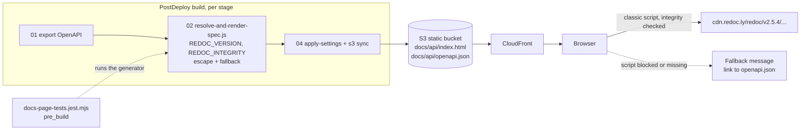
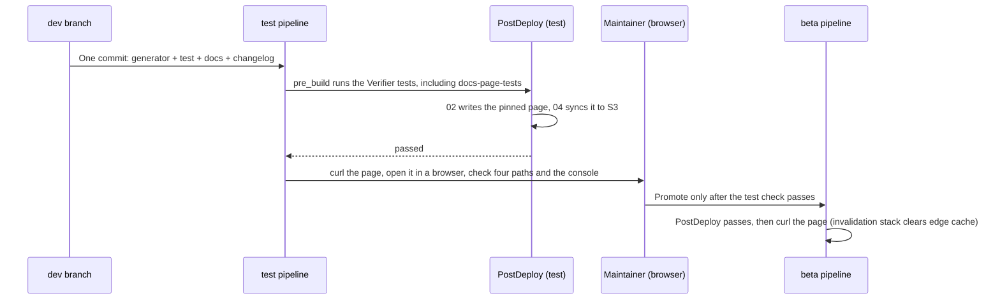

# Design Document

## Overview

This design makes the generated API reference page load one exact, integrity-checked Redoc 2 release instead of the moving `latest` path, so a vendor change cannot blank it again. It also makes the generated HTML safe to embed, gives the page a visible message when the script cannot load, and adds a regression test to a package the post-deploy build already runs. The page change is a few lines in one generator file. Most of the work is the test, the developer page, and the rollout checks.

[requirements.md](requirements.md) says what must be true. [PLAN.md](PLAN.md) holds the reproduction, the live probes, and the locked decisions (Q1 to Q7, D1 to D11). This document says exactly what changes in each file, how it is verified, and in what order.

### Design principles

1. **A named release plus its hash.** The page states one Redoc version and the SHA-384 digest of its bytes. The browser refuses anything else, and a bump is a reviewed commit.
2. **Change only what is broken.** The breadcrumb, footer, inline spec, options, and `Redoc.init` call stay as they are. The old generator tests keep matching without edits (D6).
3. **Fail visibly.** When the script cannot load, the container gets a message and a download link instead of staying empty.
4. **The test runs where builds run.** It lives in `tests/postdeploy-verify`, which `buildspec-postdeploy.yml` installs and runs in `pre_build`. It reads no network, so a CDN outage cannot fail a build.
5. **No infrastructure change.** No template, IAM, pipeline, buildspec behavior, cache header, or invalidation change. CloudFront invalidation belongs to a separate stack (Decision Q7).

### What is not designed here

Redoc 3 migration, self-hosting the bundle, replacing the generator, the `amazon-cognito-identity-js` tags on the sign-in pages (`0-0-8-pin-auth-page-cdn-script`), a post-deploy check of published pages, and anything under `tests/postdeploy` (Requirement 9).

## Architecture

### How the page is built and where it breaks or holds



The generator runs once per PostDeploy and writes a static file. Everything after that point happens in the visitor's browser, which is why no build step ever noticed the failure.

### Rollout order



The test stage has `Managed-CachingDisabled`, so the new page appears there immediately. Beta and prod use a 24-hour default TTL; clearing it is the job of the separate invalidation stack (Decision Q7, D11).

## Components and edits

All paths are relative to the repository root. `INFRA` below means `application-infrastructure`.

### 1. Generator: pin, escape, fallback (Requirements 1 to 4)

File: `INFRA/postdeploy-scripts/resolve-and-render-spec.js`. It is a CommonJS script that runs at load, so the edit keeps its shape: constants and two small functions near the top, the template literal at the bottom.

#### 1.1 Constants (Requirement 1)

Add after the `require` lines:

```javascript
// >! The API page runs a third-party script on the same origin as the sign-in
// >! pages (/login/, /register/, /profile/). Load one exact release and the
// >! SHA-384 digest of its bytes, never a moving path such as /latest/ or /v2.x/:
// >! a vendor release changed /latest/ to an ES module and blanked this page.
// >! To change the version, follow docs/developer/api-reference-page.md.
const REDOC_VERSION = '2.5.4';
const REDOC_INTEGRITY = 'sha384-w447zOpYfw/1Tv/5AK9NfHTlQIqE3RVR6KY62jCyy9zNDgO64cMwGGP1Fj0zJVf5';
const REDOC_BUNDLE_URL = `https://cdn.redoc.ly/redoc/v${REDOC_VERSION}/bundles/redoc.standalone.js`;

/** Path of the OpenAPI description published beside the page by 04-consolidate-and-deploy.sh. */
const OPENAPI_DOWNLOAD_PATH = '/docs/api/openapi.json';
```

The digest above is the value measured on 2026-11-06 for 1,103,471 bytes. Implementation step 1 recomputes it from both CDNs and uses the recomputed value (Requirement 1.4).

#### 1.2 Escaping helpers (Requirement 3)

```javascript
/**
 * Escape text for use inside HTML element content or a quoted attribute.
 *
 * @param {*} text - Value to escape; converted to a string first
 * @returns {string} The text with & < > " ' replaced by character references
 * @example
 * escapeHtml('A <b> & "c"'); // 'A &lt;b&gt; &amp; &quot;c&quot;'
 */
function escapeHtml(text) {
  return String(text)
    .replace(/&/g, '&amp;')
    .replace(/</g, '&lt;')
    .replace(/>/g, '&gt;')
    .replace(/"/g, '&quot;')
    .replace(/'/g, '&#39;');
}

/**
 * Serialize a value as JSON that is safe inside an inline <script> element.
 *
 * @param {*} value - JSON-serializable value
 * @returns {string} JSON text with every "<" written as \u003c
 * @example
 * serializeForInlineScript({ a: '</script>' }); // '{"a":"\\u003c/script>"}'
 */
function serializeForInlineScript(value) {
  // >! A "</script>" or "<!--" inside a description would end or hide the script and
  // >! blank the page. "<" can only occur inside a JSON string, where \u003c is the
  // >! same character, so JSON.parse of the result returns the original value.
  return JSON.stringify(value).replace(/</g, '\\u003c');
}
```

Why this is exact: JSON structure never uses `<`, so the replacement touches string contents only. A string that already ends in a backslash (`\\` in JSON) is followed by `<` written as `\u003c`, and `\\` plus `\u003c` parses back to a backslash and `<`. Round trip holds for every JSON value.

`escapeHtml` is used for the title only. The embedded JSON is never HTML-escaped, because script content is not decoded as HTML.

#### 1.3 Template changes (Requirements 1, 2, 3, 4)

The existing template literal keeps every line it has. The edits are marked below.

```javascript
const title = escapeHtml((resolved.info && resolved.info.title) || 'API Reference');   // escaped (Req 3.2)

const html = `<!DOCTYPE html>
<html lang="en">
<head>
  <meta charset="utf-8" />
  <meta name="viewport" content="width=device-width, initial-scale=1" />
  <title>${title}</title>
  <style>
    ... existing rules unchanged ...
    .redoc-fallback { margin: 1rem; padding: 1rem; border: 1px solid #e0e0e8; border-radius: 4px; color: #4a4a68; }   /* new */
  </style>
</head>
<body>
  <nav aria-label="Breadcrumb" class="breadcrumb-nav"> ... unchanged ... </nav>
  <div id="redoc-container"></div>
  <noscript>
    <p class="redoc-fallback">JavaScript is required to show the interactive API reference.
    <a href="${OPENAPI_DOWNLOAD_PATH}">Download the OpenAPI description</a>.</p>
  </noscript>
  <footer>
    {{{settings.footer}}}
  </footer>
  <script>document.getElementById('copyright-year').textContent = new Date().getFullYear();</script>
  <script src="${REDOC_BUNDLE_URL}" integrity="${REDOC_INTEGRITY}" crossorigin="anonymous"></script>
  <script>
    var spec = ${serializeForInlineScript(resolved)};
    Redoc.init(spec, {
      scrollYOffset: 0,
      hideDownloadButton: false
    }, document.getElementById('redoc-container'));
  </script>
  <script>
    if (typeof Redoc === 'undefined') {
      document.getElementById('redoc-container').innerHTML =
        '<p class="redoc-fallback" role="alert">The interactive API reference could not be loaded. ' +
        '<a href="${OPENAPI_DOWNLOAD_PATH}">Download the OpenAPI description</a> instead.</p>';
    }
  </script>
</body>
</html>`;
```

Notes on the choices:

- **Classic script, no `type="module"`.** The pinned release is a UMD bundle that defines `window.Redoc` (Requirement 1.6).
- **`var spec = …;` then `Redoc.init(`.** Unchanged adjacency (Requirement 2.3). The old regex `/var spec = ({[\s\S]*?});\s*\n\s*Redoc\.init/` still extracts the spec, and `\u003c` parses back under `JSON.parse`.
- **The fallback is its own `<script>`.** When the Redoc tag is blocked, fails the integrity check, or throws a syntax error, `Redoc` stays undefined, the init script throws a `ReferenceError`, and the next script still runs. A `try`/`catch` around `Redoc.init` would have broken the adjacency, so none is used.
- **The fallback text is static.** It contains no value from the spec (Requirement 4.2). It uses `innerHTML` on a fixed string, which has no injection surface.
- **When Redoc loads, the fallback does nothing** (Requirement 4.4). The check is false and the container is left to Redoc.
- **`.redoc-fallback` styles** reuse the border and text colors already in the page's inline styles.

#### 1.4 Prototype check

The code in 1.1 to 1.3 was applied to a scratch copy of the generator (outside the repository, since removed) and run on a spec whose title and description contain `</script>` and `<!--`. Results: the raw payload does not appear in the page; the title is escaped; the old `var spec … Redoc.init` regex still matches; the embedded value round-trips through `JSON.parse` unchanged; the script that holds `var spec` has no `<`; all four inline scripts parse; the fallback writes its message when `Redoc` is undefined and does nothing when it is defined; and the usage line is unchanged. This does not replace the committed test (section 2).

#### 1.5 What does not change

The `$ref` resolution (`resolvePointer`, `deref`), the circular-reference stub, the null filtering, `x-circular-ref` removal, the server URL substitution, the CLI usage line, the exit codes, and the success log line (Requirements 2.4, 2.5).

#### 1.6 Interaction with `apply-settings.js`

`04-consolidate-and-deploy.sh` runs `apply-settings.js` over every `.html` file in `build/final`. It replaces `{{{settings.footer}}}` and rewrites the API Gateway URL to the custom domain. Neither touches the `<script>` attributes or the `\u003c` escapes. The Redoc URL is on `cdn.redoc.ly`, not on the API Gateway host. No change to that script is needed.

### 2. Regression test (Requirement 5)

File: `INFRA/tests/postdeploy-verify/docs-page-tests.jest.mjs`. ESM, `@jest/globals`, no new dependency. The package's `testMatch` is `**/*.jest.mjs`, so Jest discovers it, and `npm test` already runs the Jest binary directly.

#### 2.1 Structure

```javascript
/**
 * Docs page tests.
 *
 * Runs the API page generator (postdeploy-scripts/resolve-and-render-spec.js) with the
 * Node binary against small inline OpenAPI documents and checks the page it writes:
 * an exact, integrity-protected Redoc script, safe embedding, and a visible fallback.
 * Nothing reads the network or AWS. The integrity value cannot be checked against the
 * CDN here; the implementation checks it once (design V-B) and a browser enforces it.
 *
 * Validates: Requirements 1.1 to 1.3, 1.6, 2.1 to 2.5, 3.1 to 3.4, 4.1 to 4.4, 5.2 to 5.8
 */
import fs from 'node:fs';
import os from 'node:os';
import path from 'node:path';
import { execFileSync } from 'node:child_process';
import { fileURLToPath } from 'node:url';
import { describe, it, expect, beforeAll, afterAll } from '@jest/globals';

/** Absolute path of the generator under test. */
const GENERATOR_PATH = fileURLToPath(
  new URL('../../postdeploy-scripts/resolve-and-render-spec.js', import.meta.url)
);
```

Helpers (each with a JSDoc block, per the documentation standard):

| Helper | Job |
|--------|-----|
| `generate(spec)` | Write `spec` as JSON to a file in the shared temp directory, run `execFileSync(process.execPath, [GENERATOR_PATH, input, output], { timeout: 15000, stdio: 'pipe' })`, return the HTML text. A fresh file name per call. |
| `findRedocTag(html)` | Return the attributes of the one `<script>` whose `src` contains `redoc.standalone.js`; fail the test if there is not exactly one. |
| `extractEmbeddedSpec(html)` | Apply `/var spec = ({[\s\S]*?});\s*\n\s*Redoc\.init/` (the Old generator tests' regex) and return the matched JSON text, or `null`. |
| `scriptHolding(html, marker)` | Return the body of the `<script>` element that contains `marker`, split on `</script>` boundaries. |

`beforeAll` makes one directory with `fs.mkdtempSync(path.join(os.tmpdir(), 'docs-page-'))`; `afterAll` removes it with `fs.rmSync(dir, { recursive: true, force: true })`. Child processes are started with `execFileSync` and an argument array, so no shell interprets a path or a value (`// >!` comment at the call).

#### 2.2 Inputs

```javascript
/** Minimal OpenAPI document: no $ref, no server variables, plain title. */
const PLAIN_SPEC = {
  openapi: '3.0.0',
  info: { title: 'Docs Page Test API', version: '1.0.0' },
  paths: { '/ping': { get: { summary: 'Ping', responses: { 200: { description: 'ok' } } } } }
};

/** Title and description carry text that would end or hide a script. */
const HOSTILE_PAYLOAD = '</script>';
const HOSTILE_SPEC = {
  ...PLAIN_SPEC,
  info: { title: `T ${HOSTILE_PAYLOAD}`, description: `D ${HOSTILE_PAYLOAD} <!-- x`, version: '1.0.0' }
};

/** $ref and a self-referencing schema, to show resolution still works. */
const REF_SPEC = {
  ...PLAIN_SPEC,
  paths: { '/n': { get: { responses: { 200: { description: 'ok', content: { 'application/json': { schema: { $ref: '#/components/schemas/Node' } } } } } } } },
  components: { schemas: { Node: { type: 'object', properties: { child: { $ref: '#/components/schemas/Node' } } } } }
};
```

#### 2.3 Tests

| Test (it) | Asserts | Requirement |
|-----------|---------|-------------|
| names an exact Redoc release | The Redoc tag's `src` matches `^https://cdn\.redoc\.ly/redoc/v\d+\.\d+\.\d+/bundles/redoc\.standalone\.js$`, and contains neither `latest` nor `.x/` | 1.3, 5.3 |
| protects the script with integrity | `integrity` matches `^sha384-[A-Za-z0-9+/]{64}$`; `crossorigin` is `anonymous` | 1.2, 5.3 |
| matches the script style to the pinned major | Major `2` → no `type="module"` and the page contains `Redoc.init(`. Any other major → `throw new Error('Generator supports Redoc 2 only; see docs/developer/api-reference-page.md')` | 1.6, 5.5 |
| keeps the page structure | `redoc-container`, the exact string `{{{settings.footer}}}`, `<nav aria-label="Breadcrumb"`, `aria-current="page">API Reference</li>`, and the init options `scrollYOffset: 0` and `hideDownloadButton: false` | 2.1, 2.2, 5.4 |
| keeps `var spec` directly before `Redoc.init` | `extractEmbeddedSpec` returns text (non-null) | 2.3 |
| embeds the spec so that it parses back | `JSON.parse(extractEmbeddedSpec(html))` deep-equals `PLAIN_SPEC` | 5.6 |
| writes no `<` in the script that holds the spec | `scriptHolding(html, 'var spec')` contains no `<` for `HOSTILE_SPEC`; the parsed value deep-equals `HOSTILE_SPEC` | 3.1, 5.6 |
| shows hostile text only as escaped data | The raw `HOSTILE_PAYLOAD` appears nowhere in the page; `<title>` equals `T &lt;/script&gt;&lt;img src=x onerror=alert(1)&gt;` | 3.2, 3.4, 5.7 |
| still resolves references and cycles | For `REF_SPEC`, the embedded spec contains no `"$ref"` key | 2.4 |
| has a fallback and a noscript note | A `<script>` containing `typeof Redoc === 'undefined'` exists and comes after the script holding `Redoc.init`; both it and the `<noscript>` element contain `href="/docs/api/openapi.json"` | 4.1, 4.3, 5.8 |
| runs the fallback only when `Redoc` is undefined | Evaluate the fallback script's body with `new Function('document', body)` against a stub `document` whose `getElementById` returns a recording element, once with `globalThis.Redoc` undefined and once defined; the element's `innerHTML` is set only in the first case and contains the download link | 4.1, 4.4 |
| prints the usage line and exits 1 without arguments | `execFileSync(process.execPath, [GENERATOR_PATH])` throws with `status === 1`; stderr contains `Usage:` | 2.5 |

The fallback behavior test needs `typeof Redoc` to be evaluated in the stub's scope. Because `new Function` runs in the global scope, the test sets and deletes `globalThis.Redoc` around each call and restores it in a `finally` block.

The test count is about a dozen `it` blocks sharing three generator runs per input (generation is memoized per spec inside `beforeAll`), so the file takes well under the unit-test budget. It spawns at most four child processes, each with a 15-second timeout, never `npm test`, and cannot recurse into the suite.

#### 2.4 What the test deliberately does not check

- That the integrity value is the real digest of the CDN's bytes. That needs the network and a moving target; it is checked at implementation time (V-B) and enforced by every browser.
- That Redoc renders. That is the browser check on the test stage (V-D).

### 3. Package description (Requirement 5.9)

File: `INFRA/tests/postdeploy-verify/package.json`. Change one string:

```json
"description": "Tests for the post-deploy verifier and the API reference page generator",
```

No dependency, script, or lockfile change.

### 4. Documentation (Requirement 6)

#### 4.1 `ARCHITECTURE.md`

- Line 1006: replace `- **Redoc** — OpenAPI spec to HTML documentation (CDN, no CLI install)` with `- **Redoc** — OpenAPI spec to HTML documentation (loaded from the CDN at a pinned version with a Subresource Integrity hash; no CLI install)`.
- Step 02 in the post-deploy diagram ("single-page Redoc HTML site") stays: it is still accurate, and the box's fixed width makes edits risky for no gain. The requirement is met by leaving it.
- Add one sentence to the post-deploy section's package paragraph (the line that describes `tests/postdeploy-verify`): the package also tests the API page generator.

#### 4.2 `buildspec-postdeploy.yml`

Line 26, comment only:

```yaml
      # Note: Redoc is loaded from CDN at runtime in the generated HTML at a pinned version with an integrity hash (no CLI install needed)
```

The structure tests that parse this buildspec (`buildspec-and-wrapper-tests.jest.mjs`) read keys and commands, not comments, and `tests/postdeploy/unit/buildspec-structure.test.js` looks for the word `Redoc` in the raw text, which remains.

#### 4.3 New page `docs/developer/api-reference-page.md`

Outline. Language fences on every block; relative links.

| Section | Content |
|---------|---------|
| Overview | What `/docs/api/` is, who builds it (`02-generate-api-docs.sh`, `resolve-and-render-spec.js`), and that the browser loads Redoc at view time |
| Why the version is pinned | One paragraph: Redoc 3 became `latest`, is an ES module without a global `Redoc`, and blanked the page; the page now names one release and its hash |
| Change the pinned version | Numbered steps: (1) pick the release; (2) set `REDOC_VERSION`; (3) compute `REDOC_INTEGRITY` with `curl -sS https://cdn.redoc.ly/redoc/v<version>/bundles/redoc.standalone.js \| openssl dgst -sha384 -binary \| openssl base64 -A` and cross-check against jsDelivr `redoc@<version>`; (4) `npm test` in `tests/postdeploy-verify`; (5) deploy to test and open the page in a browser |
| Move to Redoc 3 | What changes: `<script type="module">`, `import { init }` from the bundle, no global, `hideDownloadButton` renamed `hideDownloadButtons`, `disableTelemetry: true`, light/dark theming; link to the vendor migration guide; the docs page test intentionally fails for any major other than 2 |
| Check a stage by hand | `curl` the page and look for the pinned URL; browser console checks |
| If the page is blank or shows the fallback | Look at the console: an integrity error means the hash does not match the version; a network error means the CDN is blocked or down; the download link still works |
| Related | Links to the generator, the test, this spec, and the Redoc migration guide |

The page does not describe invalidation as something this application does (Requirement 6.3). Under "Check a stage by hand" it says only that a stage behind a cache can serve the previous page for a while after a deploy, and that clearing that cache is handled outside this application.

#### 4.4 `docs/developer/README.md`

Add one line to the Guides list, after the release process entry:

```markdown
- [API reference page](api-reference-page.md) - How `/docs/api/` is generated, why the Redoc version is pinned, and how to change it
```

### 5. Changelog (Requirement 7)

File: `CHANGELOG.md`, under `### Fixed` of `[v0.0.7] (unreleased)`. Append after the last Fixed entry (before `### Security`). Text:

```markdown
- **API reference page was blank** [Spec: 0-0-7-api-reference-page-is-blank-for-published](../.kiro/specs/0-0-7-api-reference-page-is-blank-for-published/) ([#6](https://github.com/63Klabs/atlantis-mcp/issues/6)) - The page at `/docs/api/` loaded Redoc from the `latest` path of its CDN. When Redoc 3 became `latest`, the page was left loading an ES module with a classic script tag. The browser rejected it and the page showed only the breadcrumb and footer on test, beta, and prod. The page now loads the exact release `v2.5.4` with a Subresource Integrity hash, so a CDN change can no longer alter it
  - If the script cannot load (blocked, offline, or failing the integrity check), the page shows a message with a link to `/docs/api/openapi.json`, and a `<noscript>` note covers browsers without JavaScript
  - The generator escapes the embedded spec and the page title, so text such as `</script>` in an API description can no longer end the script early
  - New test `application-infrastructure/tests/postdeploy-verify/docs-page-tests.jest.mjs` checks the pinned URL, the integrity attribute, the escaping, and the fallback on every PostDeploy build
  - New developer page, [API reference page](docs/developer/api-reference-page.md), with the procedure for changing the pinned version
  - Redoc stays on the 2.x line; a move to Redoc 3 is a later change
```

The existing Fixed entries use `**Title** [Spec: …](…)` then a dash and a sentence, then indented sub-bullets; this entry matches (Requirement 7.4). No existing text changes.

## Verification design

### V-A: Tests (Requirements 5.11, 8.1, 8.2)

Following the workspace test-execution rules, check for stray processes first, set a timeout, and check again afterward:

```bash
# Check for stray test processes before starting
ps aux | grep -E "(jest|node.*test)" | grep -v grep

# The new file alone, then the whole Verifier package (its test script calls the Jest binary directly)
cd application-infrastructure/tests/postdeploy-verify
timeout 120s node --experimental-vm-modules ./node_modules/jest/bin/jest.js docs-page-tests.jest.mjs
timeout 300s npm test

# Confirm nothing is left running
ps aux | grep -E "(jest|node.*test)" | grep -v grep
```

The package may need `npm ci --include=dev` first if `node_modules` is absent locally (`NODE_ENV=production` skips dev dependencies in CodeBuild, which the buildspec already handles).

Optional (Requirement 8.2): run the Old generator tests by hand with the borrowed-dependency command from `.kiro/specs/0-0-8-revive-postdeploy-tests/ISSUE.md` ("Reproduce"), to confirm `Redoc.init` and the `var spec` regex still match. Expected: the `resolve-and-render-spec.test.js` suite passes. The three known failures in that package (landing page, settings loader) are unrelated.

### V-B: Red-green and hash checks (not committed)

1. **Hash.** Compute the digest from both hosts and confirm they agree and equal `REDOC_INTEGRITY`:

   ```bash
   curl -sS https://cdn.redoc.ly/redoc/v2.5.4/bundles/redoc.standalone.js | openssl dgst -sha384 -binary | openssl base64 -A
   curl -sS https://cdn.jsdelivr.net/npm/redoc@2.5.4/bundles/redoc.standalone.js | openssl dgst -sha384 -binary | openssl base64 -A
   ```

2. **Red.** With the fix in place, temporarily set `REDOC_VERSION` to `'x'`, then restore it; separately change the URL builder to `/latest/`. The URL test fails each time. Remove `integrity` from the tag; the integrity test fails. Restore every edit and rerun green. Nothing from this step is committed.
3. **Old behavior.** `git stash` the generator change only and run the new test file. It fails on the `latest` URL and on the missing `integrity`, which shows the test would have caught the original defect.

### V-C: Local render in jsdom (optional, not committed)

Repeat the planning reproduction against the fixed page: generate the page from `template-openapi-spec.yml` (with the `x-amazon-apigateway-*` blocks removed), inline the pinned bundle in place of the tag, load it with the `jsdom` already in `INFRA/src/static/node_modules`, and confirm `typeof Redoc === 'object'`, no script errors, and a non-empty `#redoc-container`. jsdom does not enforce `integrity`, so this proves rendering with the pinned bytes and not the hash check.

### V-D: Deployed stages (Requirement 8)

Test stage, after its PostDeploy passes:

```bash
curl -sS https://d16wymzfzyj9xi.cloudfront.net/docs/api/ | grep -o '<script src="[^"]*redoc[^"]*"[^>]*>'
# Expected: src ends /redoc/v2.5.4/bundles/redoc.standalone.js, with integrity="sha384-…" and crossorigin="anonymous"
```

Then, in a browser, the maintainer opens the page and confirms the four paths render and the console has no integrity, CORS, or script errors. This is the only check that enforces the integrity hash, so it is required (Requirement 8.4). The same two checks run on beta after its PostDeploy (`https://mcp-beta.atlantis.63klabs.net/docs/api/`) and on prod after 0.0.7 is released (`https://mcp.atlantis.63klabs.net/docs/api/`). A stale page on beta or prod is reported to the owner of the invalidation stack.

## Error handling and rollback of the change itself

| Situation | Behavior |
|-----------|----------|
| Generator input is not valid JSON | `JSON.parse` throws, the script exits non-zero, `02-generate-api-docs.sh` fails the build (unchanged) |
| Integrity value does not match the served bytes | The browser blocks the script, the console logs the integrity error, the fallback appears; the build is green because the build cannot see it. The test-stage browser check (V-D) catches it before promotion |
| CDN unreachable or blocked | Same visible result as above: fallback with the download link |
| The vendor removes the pinned path | Same; the developer page names the self-host alternative as the next step |
| A later contributor bumps to Redoc 3 without migrating | The docs page test fails with a message pointing to the developer page |
| The change must be backed out | Revert the commit and rerun PostDeploy for the stage; `aws s3 sync --delete` replaces the page. This restores the blank page, so a better rollback is to fix forward |

## Security considerations

- **Integrity.** `integrity` plus `crossorigin="anonymous"` makes the browser refuse any bytes other than the reviewed release. `cdn.redoc.ly` returns `access-control-allow-origin: *`, which the integrity check requires. This removes the exposure of a vendor-controlled path executing on the same origin as the sign-in pages.
- **Embedding.** `\u003c` and HTML escaping stop spec text from ending a script or injecting markup. The spec comes from our own API Gateway export, so this is a robustness and defense-in-depth measure.
- **Fallback.** The fallback is static text with a fixed same-origin link. It adds no input surface.
- **No new data flow.** No cookie, token, or telemetry is added. Redoc 2 makes no telemetry call; the telemetry concern applies to the later Redoc 3 migration, where `disableTelemetry: true` is required.
- **CSP.** None exists on the static site (verified for all three distributions on 2026-11-06). Adding one is outside this repository (Requirement 9.2).

## Requirement traceability

| Requirement | Design section | Verified by |
|-------------|----------------|-------------|
| 1 Pinned, integrity-protected script | 1.1, 1.3 | docs-page tests (URL, integrity, classic); V-B hash; V-D curl and browser |
| 2 Structure and behavior unchanged | 1.3, 1.5 | docs-page tests (structure, adjacency, refs, usage line); optional Old generator tests |
| 3 Safe embedding | 1.2, 1.3 | docs-page tests (no `<`, escaped title, hostile payload) |
| 4 Visible failure | 1.3 | docs-page tests (fallback present, behavior with and without `Redoc`, `<noscript>`) |
| 5 Regression test | 2, 3 | `npm test` in `tests/postdeploy-verify` (V-A) |
| 6 Documentation | 4 | Review against the documentation standard; links resolve |
| 7 Changelog | 5 | Review against `changelog-convention.md` |
| 8 Verification and rollout | Verification design | V-A to V-D |
| 9 Scope boundaries | What is not designed here; edits listed per file | `git status` shows only the files named in "Implementation order" |

## Implementation order

1. Recompute the integrity value from both CDNs (V-B step 1). If `2.5.4` is no longer served, stop and ask.
2. Edit the generator: constants, helpers, template (section 1).
3. Write `docs-page-tests.jest.mjs` and change the package description (sections 2 and 3). Run V-A.
4. Run the red-green checks (V-B steps 2 and 3), restoring every temporary edit.
5. Write the developer page, the README line, the `ARCHITECTURE.md` edits, and the buildspec comment (section 4).
6. Add the changelog entry (section 5).
7. Run V-A again, and V-C if jsdom is available. Review `git status`: expected files are the generator, the new test, `package.json` of the Verifier tests, the new developer page, `docs/developer/README.md`, `ARCHITECTURE.md`, `buildspec-postdeploy.yml`, and `CHANGELOG.md`.
8. The owner commits to `dev` and promotes `dev → test`, then follows V-D.

## Open points carried into implementation

- **Newest 2.x release.** `v2.5.4` is the release measured and reasoned about. If a newer 2.x exists at implementation time, keep `2.5.4` unless you ask for the newer one, because every check above was made against it.
- **Browser check is manual.** No browser automation exists in this repository. The maintainer performs the check in V-D on test and beta; the implementer can run V-C and the `curl` checks.
- **Prod page stays blank until 0.0.7 ships** (Decision Q4). Nothing in this design changes that.
- **Beta and prod edge cache.** If the old page is still served on beta well after PostDeploy, the owner of the invalidation stack is told; this design adds no invalidation (Decision Q7).
