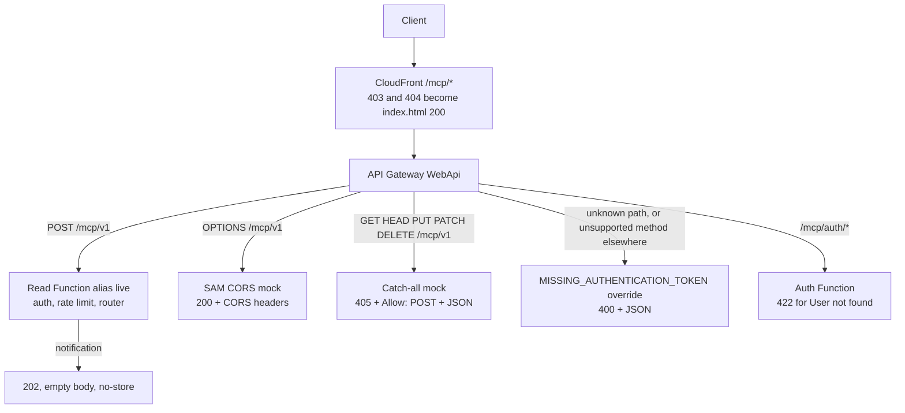
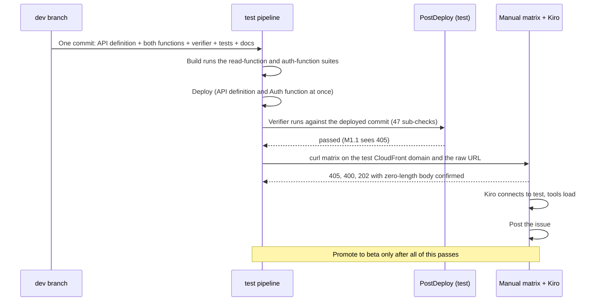

# Design Document

## Overview

This design makes every method other than `POST` and `OPTIONS` on `/mcp/v1` answer a JSON `405` with `Allow: POST`, produced by an API Gateway mock integration, and closes the three other ways the API reaches a client as the site's landing page or as a stray body: unknown routes, the notification `202`, and the Auth function's `404 User not found`. It adds two post-deploy checks so the deployed API proves the `405` on every deployment. The API change is one file (`template-openapi-spec.yml`). The code changes are a few lines in the Read and Auth functions. Most of the work is the tests and the guards around them.

[requirements.md](requirements.md) says what must be true. [PLAN.md](PLAN.md) holds the evidence and the locked decisions (D1 to D12). This document says exactly what changes in each file, how it is verified, and in what order.

### Design principles

1. **Answer at the lowest layer that can.** A `GET` carries no information the Lambda needs, so API Gateway answers it. Auth, the rate limiter, and a cold start never run for a response that cannot differ.
2. **Never emit a 403 or a 404.** The Edge rewrites both to `index.html` with 200, so the API cannot use them for anything a JSON client reads. Each status this change introduces (`405`, `400`, `422`) sits outside that pair, and a test in each function guards it.
3. **A test must see the same bytes the client sees.** The notification defect passed because the tests stopped before `Response.finalize()`. The new test uses the real cache-data classes.
4. **The guard does not share the server's reading of the contract.** The verifier and its fake restate `405` and `Allow: POST` themselves and import nothing from Lambda code.
5. **No new infrastructure.** No `template.yml` resource, IAM, parameter, layer, or CloudFront change.
6. **Prove it before promoting it.** The change goes to `test`, the matrix in Requirement 13 is run there, and nothing moves to `beta` until it passes.

### What is not designed here

A verifier check for notifications or for the unknown-route `400` (D8, Requirement 14.6). Any change to the upstream CloudFront template. A new status for the Auth function's other errors. A change to the `profile` page. A fix in `@63klabs/cache-data` itself (see Open points).

## Architecture

### Which layer answers which request



The `405` mock and the `400` override are answered by API Gateway and never reach a Lambda. Both statuses, like the Auth function's `422`, are outside the pair the Edge rewrites, so the client sees them unchanged.

### Rollout order



The API definition and the Auth function change at once on every stage. The Read function shifts gradually on `beta` and `prod` (CodeDeploy, about 30 minutes), so the notification fix lands after the API change there. No verifier check depends on the notification fix (D8).

## Components and edits

All paths are relative to the repository root. `INFRA` is `application-infrastructure`, `RF` is `INFRA/src/lambda/read-function`, `AF` is `INFRA/src/lambda/auth-function`, and `VT` is `INFRA/tests/postdeploy-verify`.

### 1. API definition (Requirements 1, 2, 3)

File: `INFRA/template-openapi-spec.yml`. No other API file changes (Requirement 14.1).

**Verified offline during design (2026-11-06).** A mini template with the same `Cors` block, a `POST` `aws_proxy` operation to `${ReadLambdaFunction.Alias}`, the catch-all mock, and the gateway-response block, translated with `aws-sam-translator` 1.116.0, produced: the `post` operation unchanged; an `options` operation (SAM's CORS mock) with `Access-Control-Allow-Methods: 'POST,OPTIONS'`; the catch-all kept as written; `x-amazon-apigateway-gateway-responses` kept at the document root; and one `AWS::Lambda::Permission`, for `POST /mcp/v1` on the alias. No resource or permission was added for the mock. The same translation is repeated against the real file during implementation (section V-C).

**The catch-all operation.** Added to the `/mcp/v1` path item, after `post`:

```yaml
    # >! Every method other than POST (and OPTIONS, which SAM's Cors block answers) gets 405.
    # >! Without this, API Gateway answers a GET with its built-in 403, and CloudFront rewrites
    # >! every 403 and 404 to /index.html with 200, so a client that opens a GET (Kiro does, per
    # >! the Streamable HTTP transport) parses the landing page as JSON and fails to connect.
    # >! A mock, not the Read function: the answer carries no information, so it needs no API key,
    # >! writes no rate-limit counter, and starts no Lambda. A specific method defined later on
    # >! this path takes precedence over this catch-all. Never replace 405 with 403 or 404.
    x-amazon-apigateway-any-method:
      summary: "Methods other than POST"
      description: "This endpoint accepts POST only. Any other method gets 405 with Allow: POST and a JSON body. No event stream is offered."
      responses:
        '405':
          description: "Method not allowed - this endpoint accepts POST only"
          headers:
            Allow:
              description: "The method the endpoint accepts"
              schema:
                type: string
                example: "POST"
            Access-Control-Allow-Origin:
              schema:
                type: string
            Cache-Control:
              schema:
                type: string
            Content-Type:
              schema:
                type: string
          content:
            application/json:
              schema:
                $ref: '#/components/schemas/MessageResponse'
      x-amazon-apigateway-integration:
        type: mock
        passthroughBehavior: when_no_match
        requestTemplates:
          application/json: '{"statusCode": 405}'
        responses:
          default:
            statusCode: '405'
            responseParameters:
              method.response.header.Allow: "'POST'"
              method.response.header.Access-Control-Allow-Origin: "'*'"
              method.response.header.Cache-Control: "'no-store'"
              method.response.header.Content-Type: "'application/json'"
            responseTemplates:
              application/json: '{"message": "Method not allowed. This endpoint accepts POST only."}'
```

Design notes:
- **Why a request template and `when_no_match`.** A mock reads `statusCode` from the integration request body. The `application/json` template makes that body constant for any JSON request, whatever the client sent. A request with another content type, or none, matches no template and passes through; with `when_no_match` it is not rejected with `415`, and because only the `default` integration response exists, the mock answers it whatever the pass-through body contains. This is the documented mock behavior (a method can return the default integration response without a request template); the matrix in V-D confirms it for `Content-Type: text/plain` and `Accept: text/event-stream`, which AWS's documentation does not state in so many words. **Fallback if the matrix shows a `415`, a `500`, or an empty body:** duplicate the response template under the content type the client sent (or the `Accept` value Kiro sends), or drop the request template and rely on the default response alone. The fallback changes only this file.
- **`Content-Type` is set explicitly** so the answer does not depend on how API Gateway picks a response content type for a mock.
- **HEAD** gets the same status and headers. Clients ignore the body of a HEAD response.
- The `405` body wording is fixed here: `Method not allowed. This endpoint accepts POST only.`

**The shared schema.** Added to `components.schemas`, beside `AuthError`:

```yaml
    MessageResponse:
      type: object
      required:
        - message
      properties:
        message:
          type: string
          description: "Human-readable explanation"
          example: "Method not allowed. This endpoint accepts POST only."
```

**The unknown-route response.** Added at the document root, after `info`:

```yaml
# >! API Gateway answers a request that matches no operation (an unknown path, or an unsupported
# >! method on a path other than /mcp/v1) with MISSING_AUTHENTICATION_TOKEN, status 403 by default.
# >! CloudFront rewrites 403 and 404 to /index.html with 200, so the status here must stay outside
# >! that pair. 400 matches what the Read function already returns for an unknown route.
x-amazon-apigateway-gateway-responses:
  MISSING_AUTHENTICATION_TOKEN:
    statusCode: '400'
    responseTemplates:
      application/json: '{"message": "Unsupported path or method for this API."}'
```

The override lives in the Spec file, not in `WebApi`'s `GatewayResponses`, so `template.yml` stays untouched (Requirement 3.6, 14.1). The template contains no `$` or `#`, so the VTL evaluation of the template cannot change it. No other gateway response type is overridden (Requirement 3.4).

**Auth documentation in the same file.** The profile and voucher-redeem `'404'` entries become `'422'` ("Unprocessable - the token is valid but the account has no user record"), keeping their schema references (`AuthError` for profile, `MCPError` for voucher redeem). The key-regenerate operation gains a `'422'` entry with the same description and the `MCPError` reference its `401` uses. After the change no operation in the file declares `'403'` or `'404'`.

**What does not change:** the `post` operation; `template.yml`; the `McpV1Post` event; the CORS block.

### 2. Notification 202 without a body (Requirement 4)

File: `RF/routes/index.js`. The router (`utils/json-rpc-router.js`) is unchanged: it already returns `{ statusCode: 202, headers, body: '' }` for a notification (Requirement 4.7).

The defect, reproduced during design against the real classes: `response.setBody(null)` calls `set({ body: null })`, and `set()` assigns a body only `if (obj?.body)`, so the generic `200` template's `{ message: "Success" }`, installed by `new Response()`, survives into `finalize()`. `finalize()` itself keeps a `null` body as `null` and logs 0 bytes; with `_body` cleared the probe returned `{"s":202,"body":null}`, `Cache-Control: no-store`, `Expires: 0`, and a `[RESPONSE] 202 | 0 | ...` log line.

The mapping layer clears the body itself and sets the cache headers before `finalize()` adds `max-age`. A module-level helper above `process`:

```javascript
/**
 * Make a response carry no body and forbid caching it.
 *
 * A notification is answered with 202 and no body (MCP Streamable HTTP, 2025-11-25).
 *
 * >! cache-data's Response.set() ignores a falsy body, so setBody(null) leaves the generic 200
 * >! template's {"message":"Success"} in place. The only way to send no body is to clear the
 * >! field, and a test with the real Response (tests/unit/routes/routes-notification-response.test.js)
 * >! fails if cache-data renames it.
 * >! Cache-Control and Expires are set here because finalize() adds max-age=<routeExpirationInSeconds>
 * >! to any status below 400 unless the application set them.
 *
 * @param {Response} response - Response instance to change
 * @returns {void}
 * @example
 * respondWithoutBody(response);
 * // response.finalize().body === null
 */
const respondWithoutBody = (response) => {
  response._body = null;
  response.addHeader('Cache-Control', 'no-store');
  response.addHeader('Expires', '0');
};
```

and the branch in `process` becomes:

```javascript
    response.setStatusCode(jsonRpcResponse.statusCode);
    if (jsonRpcResponse.body === '') {
      // >! A notification's 202 has no body; JSON.parse('') would throw, and setBody(null) is ignored
      respondWithoutBody(response);
    } else {
      response.setBody(JSON.parse(jsonRpcResponse.body));
    }
```

The router's headers are still copied by the existing loop (`Content-Type` and `Access-Control-Allow-Origin` stay with cache-data, `X-MCP-Version` is copied). The handler's rate-limit headers and `X-MCP-Version` were added to the `Response` before routing and are kept. `finalize()` adds `Access-Control-Allow-Origin: *`, `Content-Type: application/json` (harmless on an empty body), and `x-exec-ms`. The JSDoc of `process` gains one line about the empty-body case.

**Why here and not elsewhere.**
- *In the handler, after `finalize()`:* the `[RESPONSE]` log line would record 21 bytes and the CloudWatch dashboard parses that line.
- *A raw object like the 401 and 429 paths:* skips `finalize()`, so CORS, the execution-time header, and the response log line are lost.
- *A `Response` subclass:* a new type for one status, and 105 test files mock the cache-data module.
- *`reset({ body: '' })`:* `reset` also goes through `set()`, with the same falsy test.

The remaining cost is one write to an underscore field (`_body`). It is a public class field, not a `#private` one, and the real-`Response` test makes a rename fail in CI.

### 3. Auth function status (Requirement 5)

**One definition.** New file `AF/utils/status-codes.js`:

```javascript
/**
 * HTTP statuses the Auth function chooses for conditions that API Gateway or CloudFront
 * would otherwise turn into the site's landing page.
 *
 * >! CloudFront rewrites every origin response with status 403 or 404 to /index.html with
 * >! status 200, so "not found" cannot be a 404 here. A JSON client would parse HTML.
 *
 * @module utils/status-codes
 */
'use strict';

/** Valid token, but no Users record for the account. */
const USER_NOT_FOUND_STATUS = 422;

/** A request that matches none of the Auth function's routes. */
const UNKNOWN_ROUTE_STATUS = 400;

module.exports = { USER_NOT_FOUND_STATUS, UNKNOWN_ROUTE_STATUS };
```

**Edits:**

| File | Change |
|------|--------|
| `AF/services/profile.js:86`, `AF/services/key-regenerate.js:52`, `AF/services/voucher-redeem.js:209` | `error.statusCode = USER_NOT_FOUND_STATUS;` and the JSDoc `@throws` line says 422 |
| `AF/controllers/profile.js:70-71`, `AF/controllers/key-regenerate.js:70-71`, `AF/controllers/voucher-redeem.js:105-106` | `else if (error.statusCode === USER_NOT_FOUND_STATUS) { response.setStatusCode(USER_NOT_FOUND_STATUS); response.setBody({ error: 'User not found' }); }`; the `// On 404:` example comments say 422 |
| `AF/routes/index.js:65-69` and its header comment (`No match → 404 Not found`) | `response.setStatusCode(UNKNOWN_ROUTE_STATUS)`; the `>!` comment and the header say 400 |

In `voucher-redeem.js` the branches run in the order 401, 400, 409, 422, so 422 cannot be confused with 400 or 409. The body `{ error: 'User not found' }`, the `Cache-Control` the cache-data `Response` applies (`max-age=0`, from `AF/config/responses.js`), and every other status are unchanged (Requirement 5.5). The `profile` page needs no edit: `profile/index.html` treats any non-OK, non-401 response as a failure and shows `data.error`, so key regeneration and voucher redemption now show "User not found" instead of the generic message a rewritten 404 produced (it failed `resp.json()` and landed in `.catch`).

### 4. Read Function tests (Requirement 6)

All are Jest `*.test.js` in `RF/tests`. Run with `npx jest` from `RF`.

**New: `RF/tests/unit/architecture/openapi-method-handling.test.js`.** Reads `INFRA/template-openapi-spec.yml` with `js-yaml` (the file uses the `Fn::Sub:` mapping form, so the default schema loads it), in the style of `openapi-integration-targets.test.js`. Assertions:

| ID | Assertion |
|----|-----------|
| M1 | `/mcp/v1` has `x-amazon-apigateway-any-method` whose integration `type` is `mock` and has no `uri` |
| M2 | The mock's `default` integration response has `statusCode` `'405'` and response parameters `Allow` = `'POST'`, `Access-Control-Allow-Origin` = `'*'`, `Cache-Control` = `'no-store'`, `Content-Type` = `'application/json'`; its template parses as JSON with a non-empty string `message` |
| M3 | The operation declares a `'405'` response with the four headers |
| M4 | `/mcp/v1` has exactly the operations `post` and the catch-all; `post` is `aws_proxy` and its `uri` contains `${ReadLambdaFunction.Alias}` |
| M5 | `x-amazon-apigateway-gateway-responses` overrides only `MISSING_AUTHENTICATION_TOKEN`; its `statusCode` parses to an integer that is neither 403 nor 404; its `application/json` template parses as JSON with a string `message` that does not contain `Missing Authentication Token` |
| M6 | No operation in the file declares a `'403'` or `'404'` response |

**New: `RF/tests/unit/routes/routes-notification-response.test.js`.** Does not mock `@63klabs/cache-data`. It mocks only `../../../utils/json-rpc-router` (so `handleJsonRpc` returns what the router returns for a notification, `{ statusCode: 202, headers: { 'X-MCP-Version': '1.0' }, body: '' }`) and keeps the real `ClientRequest` and `Response`. `beforeAll` calls `ClientRequest.init({ validations })` with `RF/config/validations.js` and `Response.init(responses)` with `RF/config/responses.js`, the production settings (`routeExpirationInSeconds` 3600), so the pre-fix `max-age=3600` shows up. Cases:
1. A notification through `Routes.process` then `finalize()`: `statusCode` 202; `body` is `null`; `Cache-Control` is `no-store`; `Expires` is `0`; `Access-Control-Allow-Origin` is `*`; `X-MCP-Version` is `1.0`.
2. A request with an `id` (router mock returns a `200` with a JSON body): the finalized body is that JSON and `Cache-Control` is `max-age=3600`, so Requirement 4.6 is guarded.

The test builds the `ClientRequest` from a small API Gateway event (as the design probe did) and never touches the network or AWS. It is written to fail on the current code (red) and pass after the change (green).

**Changed: `RF/tests/unit/routes/routes-mcp-v1.test.js`.** The notification case at line 133 asserted `setBody(null)`. It now asserts that the mocked response's `_body` is `null`, that `addHeader` was called with `Cache-Control` / `no-store` and `Expires` / `0`, and still that nothing throws. The `GET` case at line 161 stays (Requirement 6.4).

**Extended: `RF/tests/integration/mcp-protocol-schema-conformance.test.js:398`.** Unchanged: it asserts the router's output. Requirement 6.3 is met by the new file above, which covers the finalized response; the integration test's description is edited to say "the router returns 202 and an empty body" so it does not read as covering the whole path.

### 5. Auth Function tests (Requirement 7)

Run with `npx jest` from `AF`.

| File | Change |
|------|--------|
| `profile-controller.test.js:160-175`, `key-regenerate-controller.test.js:152-167`, `voucher-redeem-controller.test.js:254-269` | The thrown error's `statusCode` and the expected `setStatusCode` are `USER_NOT_FOUND_STATUS` (imported), asserted as 422 in the test title; header comments change `404 (user not found)` to `422` |
| `profile-service.test.js:270,284`, `key-regenerate-service.test.js:217,232`, `voucher-redeem-service.test.js:282` | The service tests expect `statusCode: 422` |
| `route-dispatcher.test.js` lines 123, 160, 196, 207, 220, 230, 240, 250, 317 and the `describe('404 for unknown paths')` title | Expect `UNKNOWN_ROUTE_STATUS` (400); titles and the header comment say 400 |
| `route-dispatcher-correctness.property.test.js` | The 404 expectation and the header comment become 400 |
| New `tests/unit/status-codes.test.js` | `USER_NOT_FOUND_STATUS` is 422 and `UNKNOWN_ROUTE_STATUS` is 400; neither is 403 or 404 |
| New `tests/unit/no-rewritten-statuses.test.js` | Reads every non-test `.js` file under `AF` (excluding `node_modules`, `tests`, and `coverage`) and fails on a match of `/\b(setStatusCode\(\s*|statusCode\s*[:=]\s*)(403|404)\b/` in executable code, naming the file and line. Comments and JSDoc are not matched because the pattern needs the call or assignment form |

### 6. Post-deploy verifier (Requirement 8)

File: `INFRA/postdeploy-scripts/verify-deployment.js`. Dependency-free CommonJS, no Lambda imports.

**HTTP client (`createHttpClient`).**
- `send()` accepts `GET` as well as `POST` and `OPTIONS`. The `TypeError` message becomes `request spec method must be POST, OPTIONS, or GET`.
- A `GET` has no body and no JSON-RPC `id` (`jsonRpcId: null`), and carries no key.
- `buildRequestHeaders(spec, carriesBody)` replaces the `isPreflight` parameter: `Content-Type: application/json` is added only for a request that carries a body (`POST`), and the key and `Authorization` are dropped for a request that carries none, as they are for a preflight today. `ctx.send` makes the same split: only a `POST` can take the effective key.
- `stats` is unchanged: a `GET` is counted in neither `posts` nor `preflights`, so `report.requests` keeps its shape (Requirement 8.7). The `stats.retries` count still includes a retried `GET`.

**Catalog.**

```javascript
// SUB_CHECK_ROWS, between P6.2 and T1.1
['M1.1', 'M1', 'C', 'GET answers 405 with Allow: POST and a JSON body'],
// SUB_CHECK_ROWS, after X2.4
['X2.5', 'X2', 'A', 'edge GET answers 405 with Allow: POST and a JSON body']

// CHECK_ORDER
['P1', 'S1', 'S2', 'P2', 'P3', 'P4', 'P5', 'P6', 'M1', 'T1', 'X1', 'X2']
```

The JSDoc counts on `SUB_CHECKS` become 47 (37 core, 10 advisory); the `CatalogRequestSpec` and `RequestSpec` `method` types gain `'GET'`.

**Request builders.** One builder, two catalog entries:

```javascript
/**
 * Build the GET probe of M1.1 and X2.5: the request Kiro sends after it connects.
 *
 * @private
 * @param {string} key - Catalog name
 * @param {('raw'|'edge')} target - Target
 * @returns {CatalogRequestSpec} Spec; it never carries a key
 */
function getSpec(key, target) {
  return { key, target, method: 'GET', headers: { Accept: 'text/event-stream' }, apiKey: null };
}

// REQUEST_BUILDERS
M1: () => getSpec('M1', 'raw'),
X2e: () => getSpec('X2e', 'edge'),
```

**Constants and judge.**

```javascript
/**
 * Status and Allow value of the answer to a method the endpoint does not serve.
 * >! Restated from the MCP Streamable HTTP transport pages (2025-11-25: the server MUST return
 * >! text/event-stream or 405; 2026-07-28: a GET or DELETE to the MCP endpoint gets 405). Not
 * >! imported from Lambda code, so a mistake in the server cannot also change what is expected.
 */
const METHOD_NOT_ALLOWED_STATUS = 405;
const ALLOWED_METHOD_VALUE = 'POST';
```

`judgeMethodNotAllowed(entry, secrets)` runs after the gate has confirmed the status. It collects problems the way X2.1 does, so one run shows everything wrong, and joins them with `; `:
- `Allow` is not exactly the one token `POST`: `Allow is <value>, expected "POST"` (using `headerText`, `headerTokens`, and `formatValue`, with an absent header shown as `undefined`);
- the content type is not JSON: `content-type is <value>, expected application/json`;
- the body is not a JSON object with a non-empty string `message`: `body is not a JSON object with a string "message"`.

It does not read the wording of `message` (Requirement 8.4).

`landingPageHint(subject)` returns a `statusHint` function. For an HTTP 200 whose `content-type` is `text/html` it returns `<subject> is answering with the site's landing page (an API 403 or 404 rewritten to /index.html)`, otherwise `null`. A 403 from a stage that still runs the old build needs no hint: the gate's reason already reads `HTTP 403, expected 405; body: {"message":"Missing Authentication Token"}`, which tells an operator the stage is on the previous build (Requirement 13.11).

**Checks.**

```javascript
async function checkM1(ctx) {
  const m1 = await ctx.request(buildRequest('M1'), {
    status: METHOD_NOT_ALLOWED_STATUS,
    jsonRpc: false,
    statusHint: landingPageHint('the target')
  });
  ctx.evaluate('M1.1', [m1], () => judgeMethodNotAllowed(m1, ctx.secrets));
}
CHECK_FUNCTIONS.M1 = checkM1;
```

`checkX2` adds, after `x2d`, `const x2e = await ctx.request(buildRequest('X2e'), { status: 405, jsonRpc: false, statusHint: landingPageHint('the edge') })` and `ctx.evaluate('X2.5', [x2e], () => judgeMethodNotAllowed(x2e, secrets))`, and its no-edge branch skips `'X2.5'` with the existing `NO_EDGE_TARGET_REASON`. `M1` uses a `raw` target, so a raw target that did not answer P1 gives the existing "not attempted" failure; `X2.5` goes only to the edge and still runs then, like the other `X2` sub-checks.

**Budget and report.** Both `GET`s are answered by API Gateway before the rate limiter, so they are not counted: the counted-POST budget stays 21 without an edge target and 24 with one. A run sends one more request than before without an edge target, and two more with one. The report and the `VERIFY_REPORT` line keep their format; only the number of `checks` entries (47) and the counts derived from the catalog change.

### 7. Fake server and verifier tests (Requirement 9)

**Fake server (`VT/helpers/fake-mcp-server.mjs`).** The routing block near line 1001 splits into two cases:

```javascript
if (url.pathname !== expectedPath) {
  // API Gateway answers an unknown route with the MISSING_AUTHENTICATION_TOKEN override
  return respond(call, 400, { 'content-type': 'application/json' }, { message: 'Unsupported path or method for this API.' });
}
if (httpMethod !== 'POST' && httpMethod !== 'OPTIONS') {
  return methodNotAllowedResponse(call, target);
}
```

An unsupported method on the expected path gets `methodNotAllowedResponse`; an unexpected path with any method gets the `400`. `methodNotAllowedResponse` answers `405`, `allow: POST`, `content-type: application/json`, `access-control-allow-origin: *`, `cache-control: no-store`, and `{ message: 'Method not allowed. This endpoint accepts POST only.' }` (no body for `HEAD`). The fake defines these values itself and imports nothing from the Read function. Two new options, in the style of `preflight` and `edgePreflight`, each an object whose `fault` member selects one failure:

| Option | Target | `fault` values |
|--------|--------|----------------|
| `methodNotAllowed` | raw | `'html'`: HTTP 200, `text/html`, an HTML page; `'no-allow'`: 405 without `Allow`; `'not-json'`: 405 with `Allow` and a `text/plain` body; `'gateway-403'`: HTTP 403 with `{"message":"Missing Authentication Token"}` (a stage on the previous build) |
| `edgeMethodNotAllowed` | edge | the same four |

`respond()` serializes JSON only, so an `'html'` and a `'not-json'` fault use a small `respondText(call, status, headers, text)` beside it. The option docs at the top of the file gain the two options.

**`fake-mcp-server-tests.jest.mjs`.** The test at line 492 (`a POST to an unknown path, or a GET, gets the gateway 403`) is split into: an unknown path gets `400` with the new message; a `GET`, `HEAD`, `PUT`, `PATCH`, and `DELETE` on the expected path get `405` with `Allow: POST` and a JSON body (none for `HEAD`); and each fault option produces its documented answer.

**`VT/checks-tests.jest.mjs`.** New `FAILURES` rows (the file's existing failure table, which the "has a failing fault for each sub-check" test reads):

| Sub-check | Fault | Expected reason |
|-----------|-------|-----------------|
| `M1.1` | `methodNotAllowed: { fault: 'html' }` | `^HTTP 200, expected 405; the target is answering with the site's landing page \(an API 403 or 404 rewritten to /index.html\); body: ` |
| `M1.1` | `methodNotAllowed: { fault: 'gateway-403' }` | `^HTTP 403, expected 405; body: \{"message":"Missing Authentication Token"\}$` |
| `M1.1` | `methodNotAllowed: { fault: 'no-allow' }` | `^Allow is undefined, expected "POST"$` |
| `M1.1` | `methodNotAllowed: { fault: 'not-json' }` | `^content-type is "text/plain", expected application/json; body is not a JSON object with a string "message"$` |
| `X2.5` | `edgeMethodNotAllowed: { fault: 'html' }` | `^HTTP 200, expected 405; the edge is answering with the site's landing page \(an API 403 or 404 rewritten to /index.html\); body: ` |

Each row asserts the reason text and, as the table's runner already does, that only the intended sub-check fails. A row for `M1.1` with the raw target down expects the existing "not attempted" reason.

**Pinned counts (all in `VT`):**

| File | Change |
|------|--------|
| `outcome-and-report-tests.jest.mjs` | `EXPECTED_SUB_CHECK_IDS` gains `M1.1` after `P6.2` and `X2.5` after `X2.4` (47); the length, core (37), and advisory (10) assertions; the "fixed nine" advisory list becomes ten and gains `X2.5`; `toHaveLength(45)` at lines 226 and 621 become 47; the summary strings and count objects at lines 538, 541, 551 are recomputed from the catalog (37 core; the advisory pass, warn, and skip counts follow from where `X2.5` lands in each case) |
| `checks-tests.jest.mjs` | The 45/36/9 assertions at lines 323-325, 329-350, 364, 380, 399, 862-865, 1055 become 47/37/10; the `passLines` length is 47 |
| `budget-tests.jest.mjs` | `COUNTED_NO_EDGE` and `COUNTED_WITH_EDGE` stay 21 and 24; `FAMILY_ORDER` gains `'M1'` between `'P6'` and `'T1'`; a new case asserts that the `GET` calls to the fake are present in `server.calls` and absent from `countedPosts` |
| `http-client-tests.jest.mjs` | A `GET` is sent with no body, no `Content-Type`, no key, and no `id`, and leaves `stats` unchanged; an unsupported method such as `PUT` still throws the updated `TypeError` |

### 8. Documentation (Requirement 10)

| File | Edit |
|------|------|
| `docs/end-user/supported-protocol-revisions.md` | A short section, "HTTP methods", before "Not supported": POST only; `GET` and `DELETE` get `405` with `Allow: POST` and a JSON body, citing the 2026-07-28 Streamable HTTP page; no event stream on any revision; an unsupported method or unknown path gets JSON `400`; a notification gets `202` with no body |
| `docs/end-user/troubleshooting/README.md` | Under Integration-Specific Issues, Kiro: the entry for `Unexpected token '<', "<!DOCTYPE "... is not valid JSON` with cause and fix (server at v0.0.7 or later). Under Authentication Problems: "User not found" now returns HTTP 422 on profile, key regeneration, and voucher redemption, and what to do (sign in again or register) |
| `docs/admin-ops/cors-and-response-headers.md` | In "Who owns what", rows for the catch-all mock (headers it sets) and the `MISSING_AUTHENTICATION_TOKEN` override; a short subsection "CloudFront turns 403 and 404 into the landing page" with the rule that no API response may use them; a note that the raw `execute-api` URL now returns `400` for an unknown route |
| `docs/developer/mcp-protocol-sources.md` | A row in the table of sources for the method rule, with the 2025-11-25 and 2026-07-28 Streamable HTTP links; a bullet under "Behavior that is easy to get wrong": no API response may be 403 or 404, with the reason. The existing bullet "A request with no `id` is a notification. It gets HTTP `202` with no body" becomes true and is not edited |
| `docs/admin-ops/post-deploy-verification.md` | Table rows `M1 method` (core, `M1.1`) and the `X2` row `X2.1 to X2.5`; "In total there are 37 core and 10 advisory sub-checks"; the order sentence gains `M1` between `P6` and `T1`; the example summary line counts |
| `docs/developer/post-deploy-verification.md` | The same rows; "evaluates 47 sub-checks"; the checklist step that names "45 sub-checks, 36 core, 9 advisory" says 47, 37, 10; a sentence that the `GET` probes are counted in neither `requests.posts` nor `requests.preflights` |
| `docs/admin-ops/voucher-management.md:103` | "If there is none, the response is 404" becomes 422 |
| `ARCHITECTURE.md` | In the dual-era / API section: a paragraph and the flowchart idea of this design (which layer answers which request) in prose, and the Edge constraint |

Every edit follows `.kiro/steering/documentation-standards-markdown.md`. A grep for `404` near `User not found`, `auth/profile`, `voucher`, and `regenerate` under `docs/` runs at the end to catch a page this table missed (Requirement 10.6).

### 9. Changelog (Requirement 11)

**Edit in place (11.1).** In the Post-Deploy Smoke Verification entry, `45 sub-checks, 36 core and 9 advisory.` becomes `47 sub-checks, 37 core and 10 advisory.` Nothing else in that bullet changes.

**New entries** under `[v0.0.7] (unreleased)`:

```markdown
### Breaking Changes
- **Auth function: "User not found" is now HTTP 422, and unmatched routes are now HTTP 400** [Spec: 0-0-7-get-on-mcp-v1-returns-html-landing-page-200](../.kiro/specs/0-0-7-get-on-mcp-v1-returns-html-landing-page-200/) - `GET /mcp/auth/profile`, `POST /mcp/auth/key/regenerate`, and `POST /mcp/auth/voucher/redeem` answer `422` instead of `404` when the token is valid but the account has no user record. CloudFront rewrites every 403 and 404 to the site's landing page with HTTP 200, so a 404 never reached the page as a 404
  - The Auth function's response for a request that matches none of its routes is `400` instead of `404`
  - An unknown path, or an unsupported method on a path other than `/mcp/v1`, at the raw `execute-api` URL is `400` with a JSON body instead of API Gateway's `403 Missing Authentication Token`
  - No migration guide or deprecation window: the service is early-stage with a small group of testers. The `profile` page needs no change

### Fixed
- **`GET` on `/mcp/v1` returned the HTML landing page** [Spec: ...](...) ([#8](https://github.com/63Klabs/atlantis-mcp/issues/8)) - ... (text as in the requirements, with the sub-bullets of 11.3)
```

The Fixed entry text and its four sub-bullets are written during implementation from the wording in Requirement 11.2 and 11.3. Order within categories follows the convention: Breaking Changes first, and within Fixed after the other v0.0.7 entries by importance.

### 10. Steering exception (Requirement 12)

File: `.kiro/steering/openapi-spec-sync.md`. A short note after "When Removing an API Endpoint":

```markdown
## Operations With No Lambda Integration

The one-to-one rule between SAM `Events` and OpenAPI operations applies to operations that invoke a
Lambda function. An operation whose integration is `mock` has no `Events` entry and needs no Lambda
permission. `/mcp/v1` carries one: an `x-amazon-apigateway-any-method` mock that answers `405` with
`Allow: POST` for every method other than `POST` and `OPTIONS`.
```

The note changes nothing else in the file.

## Verification design

### V-A: Tests (Requirements 6, 7, 9, 13.1)

Follow `.kiro/steering/test-execution-monitoring.md`: none of these tests spawns the suite.

```bash
# Check for stray test processes before starting
ps aux | grep -E "(jest)" | grep -v grep || echo "none running"

# Read Function: the files this change touches, then the whole suite
cd application-infrastructure/src/lambda/read-function
timeout 300s npx jest tests/unit/architecture/openapi-method-handling.test.js tests/unit/routes
timeout 900s npx jest
npm run lint

# Auth Function
cd ../auth-function
timeout 300s npx jest
npm run lint

# Verifier package (its test script calls the Jest binary directly)
cd ../../../tests/postdeploy-verify
timeout 600s npm test

# Static site tests, which cover the profile page and must be unaffected
cd ../../src/static && timeout 300s npm test
```

### V-B: Red-green checks (not committed)

1. Write the new `routes-notification-response.test.js` before the change and run it: case 1 fails with the body `{"message":"Success"}` and `max-age=3600`.
2. Remove `x-amazon-apigateway-gateway-responses` from the Spec file: M5 fails. Change its `statusCode` to `'404'`: M5 fails. Add a `get` operation: M4 fails.
3. Change `USER_NOT_FOUND_STATUS` to 404: `status-codes.test.js` and the controller tests fail. Add a `response.setStatusCode(404)` to any Auth file: `no-rewritten-statuses.test.js` names the file and line.
4. Make the fake return 200 HTML for a `GET`: the two `html` rows fail with the documented reasons and only the intended sub-check fails.

### V-C: Offline SAM translation of the real spec (Requirement 2.7)

Use a throwaway virtualenv (the installed `sam` is a PyInstaller bundle whose `samtranslator` cannot be imported), as in the earlier verification of the alias integration. The script reads `template-openapi-spec.yml`, wraps it as the `DefinitionBody` of a `WebApi` with the same `Cors` block as `template.yml`, adds a `ReadLambdaFunction` with `AutoPublishAlias: live` and the `McpV1Post` event, and runs `samtranslator.translator.transform.transform`. It asserts: `/mcp/v1` has `post`, `options`, and `x-amazon-apigateway-any-method`; `post` is `aws_proxy` to `ReadLambdaFunctionAliaslive`; `options` has the CORS values of `template.yml`; the document keeps `x-amazon-apigateway-gateway-responses`; the only `AWS::Lambda::Permission` is for `POST /mcp/v1`. It makes no AWS call. The virtualenv and the script are deleted afterwards, and the result is recorded in the spec's `VERIFICATION.md`.

### V-D: Deployed stage (Requirement 13)

1. The PostDeploy stage on `test` passes with 47 sub-checks, `M1.1` PASS and `X2.5` SKIP (no custom domain).
2. The matrix, against `<test-domain>` (the stage's `cloudfront.net` domain), recorded with `curl -si`:

   ```bash
   curl -si -X GET    "https://<test-domain>/mcp/v1" -H "Accept: text/event-stream"
   curl -si -X DELETE "https://<test-domain>/mcp/v1"
   curl -si -X HEAD   "https://<test-domain>/mcp/v1"
   curl -si -X GET    "https://<test-domain>/mcp/v1" -H "Content-Type: text/plain"
   curl -si -X GET    "https://<test-domain>/mcp/v1" -H "x-api-key: not-a-real-key"
   curl -si -X DELETE "https://<test-domain>/mcp/v1" -H "Content-Type: text/plain" --data "x"
   curl -si -X GET    "https://<test-domain>/mcp/not-a-route"
   curl -si -X PUT    "https://<test-domain>/mcp/auth/profile"
   curl -si -X POST   "https://<test-domain>/mcp/v1" -H "Content-Type: application/json" \
     -d '{"jsonrpc":"2.0","method":"notifications/initialized"}'
   curl -si -X GET    "https://<raw-execute-api-url>/mcp/v1" -H "Accept: text/event-stream"
   ```

   Expect `405` with `allow: POST`, `content-type: application/json`, the JSON message, `cache-control: no-store` for the first six; `400` with a JSON message for the next two; `202` with `content-length: 0` (or no body) and no `max-age=3600` for the notification; the same `405` at the raw URL. The `DELETE` with a `text/plain` body is the case most likely to need the fallback in section 1.
3. The generated `/docs/api/` page renders (the PostDeploy scripts 01 to 04 pass).
4. Kiro is pointed at the test stage and the tools load.
5. After you approve its wording, the comment on issue #8 is posted.

The notification request counts against the public tier's 50 requests per hour; the mock answers do not.

## Error handling and rollback of the change itself

| Failure | Behavior | Recovery |
|---------|----------|----------|
| The mock answers `415`, `500`, or an empty body for an unusual content type or `Accept` | The matrix or `M1.1` fails on `test` | Apply the fallback in section 1 (response template under more keys, or no request template) in the same file; no code change |
| SAM's CORS handling drops `OPTIONS` next to the catch-all | `X1.*` fails in PostDeploy, and the offline translation shows it first | Replace the catch-all with explicit `get`, `head`, `put`, `patch`, and `delete` operations that share the mock |
| The gateway-response override breaks an existing flow | A flow that relied on `403` for an unknown route fails | None known; revert the one block |
| The Auth function change is wrong | A profile, key, or voucher request returns a wrong status | Revert the commit; the Auth function has no alias, so it redeploys at once |
| `_body` is renamed in a future cache-data release | `routes-notification-response.test.js` fails on the dependency bump | Update the helper; see Open points for the upstream fix |
| A stage is verified before it runs the new build | `M1.1` fails with `HTTP 403, expected 405; body: {"message":"Missing Authentication Token"}` | Wait for the deploy and retry the PostDeploy stage |

Rollback of the whole change is a revert and a redeploy. The API definition is the only part that cannot be shifted gradually.

## Security considerations

- **Unauthenticated, static responses.** The `405` and the `400` reflect no request data and name no stage, identifier, or ARN, so there is no injection or enumeration surface. A flood of them costs API Gateway request charges and nothing else, as the 403 they replace did.
- **Less work for hostile requests.** A `GET` no longer reaches the Lambda, so it cannot spend a rate-limit write or a cold start, and an invalid key on a `GET` is not an authentication probe.
- **CORS.** `Access-Control-Allow-Origin: *` on the `405` matches the API's existing `Cors` origin policy and lets a browser-hosted client read the status. It grants nothing the preflight does not.
- **Caching.** `Cache-Control: no-store` on the `405` and on the notification `202`; the `/mcp/*` behavior already has caching disabled.
- **No account enumeration added.** `422 User not found` is returned only after the Cognito token validates, and only to the account's own holder, exactly as `404` was.
- **The verifier sends no credentials on a `GET`.** The probe carries `Accept: text/event-stream` and nothing else, and the existing redaction covers any body excerpt in a failure reason.
- **Shell and input handling.** No shell command is built from input. The new tests read files and call functions.
- **IAM.** Unchanged. The mock needs no permission, and the Auth and Read functions' policies already cover what they do.

## Requirement traceability

| Requirement | Where it is designed |
|-------------|----------------------|
| 1 (405 behavior) | Section 1 (catch-all operation, design notes), V-D matrix |
| 2 (definition) | Section 1, V-C, Section 4 (M1 to M4) |
| 3 (unknown routes) | Section 1 (gateway response), Section 4 (M5), V-D matrix |
| 4 (notification) | Section 2, Section 4 (new real-`Response` test, changed unit test) |
| 5 (Auth 422) | Section 3, Section 1 (Auth documentation) |
| 6 (Read tests) | Section 4 |
| 7 (Auth tests) | Section 5 |
| 8 (verifier) | Section 6 |
| 9 (fake and verifier tests) | Section 7 |
| 10 (documentation) | Section 8 |
| 11 (changelog) | Section 9 |
| 12 (steering) | Section 10 |
| 13 (rollout) | Rollout order, V-A to V-D |
| 14 (boundaries) | "What is not designed here", Section 1 and 6 |

## Implementation order

1. **Record the baseline.** Run the offline SAM translation against the unchanged spec (V-C) and keep the output for comparison.
2. **Write the failing tests first.** `routes-notification-response.test.js` and `no-rewritten-statuses.test.js`; confirm both fail for the stated reasons.
3. **API definition** (section 1) and the architecture test (M1 to M6); run V-C on the real file.
4. **Read Function** (section 2) and its test updates; the red test turns green.
5. **Auth Function** (section 3) and its test updates.
6. **Verifier, fake server, and their tests** (sections 6 and 7); the pinned counts change in the same step.
7. **Documentation, steering note, and changelog** (sections 8 to 10); run the grep that checks for stale `404` statements.
8. **Run every suite and both linters** (V-A). Record the results. The owner reviews `git status` and commits.
9. **Deploy to `test`** through the normal flow and run V-D.

## Open points carried into implementation

- **Mock behavior for unusual requests.** The configuration in section 1 is the documented one, but AWS's pages do not state what a mock does for a `Content-Type` that matches no template. The matrix decides; the fallback is ready.
- **Upstream defect.** `Response.set()` ignoring a falsy body is arguably a `@63klabs/cache-data` bug, since `finalize()` already says it keeps `null` as `null`. The workaround here is the `_body` write. Filing an issue at `63Klabs/cache-data` is a separate, optional step; it is not part of this spec and has not been done.
- **Requirement deltas found while designing:**
  - Requirement 6.4 says the `routes-mcp-v1.test.js` `GET` case remains. The notification case in the same file (line 133) must change, because the code no longer calls `setBody(null)`; section 4 covers it.
  - M11 in PLAN.md says cache-data applies `max-age=300` to Auth errors. The Auth function's `config/responses.js` sets both expirations to 0, so the header is `max-age=0`. Behavior is unchanged either way.
  - The verifier's `requests` counts omit the `GET` probes (section 6); the developer guide says so.
- **The Auth function's JSON-RPC-shaped schema for the voucher operation** (`MCPError` on a body that is `{ error }`) predates this change and is left alone.
