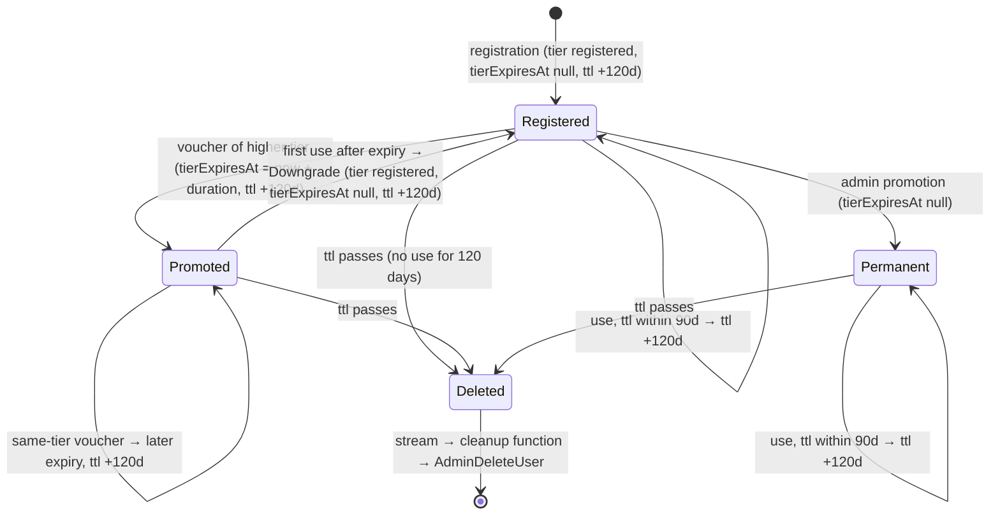
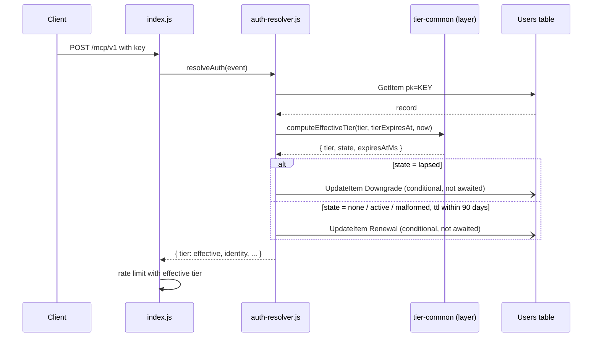

# Design Document

## Overview

This design does two things, in two deployable phases.

- **Phase 1 keeps accounts in use.** The Read Function renews `ttl` for every tier whose record has no end date, and the renewal can no longer recreate a deleted record ([issue #5](https://github.com/63Klabs/atlantis-mcp/issues/5)).
- **Phase 2 ends lapsed tiers.**
  - A new `tier-common` layer holds the expiry rule.
  - The Read Function writes a lapsed record back as `registered`, and renews active voucher users.
  - Voucher redemption never lowers what a user has.
  - The Read Function's access to the Users table is narrowed ([ISSUE.md](ISSUE.md)).

[requirements.md](requirements.md) says what must be true. [PLAN.md](PLAN.md) holds the evidence and the locked decisions. This document says what changes in each file, how each change is verified, and in what order.

### Design principles

1. **One rule, one place.** Every expiry decision goes through `tier-common`. The Read Function, the profile, and voucher redemption never parse `tierExpiresAt` themselves.
2. **The pure part is separate from the writes.** The layer only computes. Each function decides what to write from the layer's result, so the rule can be tested without mocks.
3. **Every write states what it expects.** Each Users table write carries a condition naming the values it read. A failed condition is a no-op, or a 409 in the Auth Function, never a silent overwrite.
4. **The hot path does not wait.** Read Function writes stay fire-and-forget, at most one per request.
5. **Phase 1 cannot make things worse.** It changes eligibility only, adds no infrastructure, and leaves records with an end date alone.
6. **IAM is changed last** in phase 2, so a failure on `test` points at one change.

### What is not designed here

- Changes to rate-limiter keys or windows. They are tracked in [`0-0-8-rate-limit-record-shared-across-tiers`](../0-0-8-rate-limit-record-shared-across-tiers/ISSUE.md).
- Resetting Cognito `custom:tier` on a lapse (L4).
- Writes from the profile endpoint (D13).
- Changes to registration, key regeneration, the cleanup function, the static site, or `services/documentation.js` (N13).
- Hard key lifetimes. That is the 0.0.8 `TODO.md` item.

## Architecture

### Record lifecycle after phase 2



Phase 1 delivers the `Permanent` and `Registered` renewal loops. Phase 2 adds the `Promoted` renewal, the Downgrade, and the redemption rule.

### Request path in the Read Function (phase 2)



### Rollout order

1. **Phase 1:** `auth-resolver.js`, its tests, documentation, and the changelog. Scan, promote through every stage, and check on `test`.
2. **Phase 2:** the layer, then the loaders and wiring, then the effective tier, then the Downgrade and renewal, then the redemption rule, then the IAM statements. Then documentation, the full suites, a check on `test`, and promotion.

## Components and edits

`RF` means `application-infrastructure/src/lambda/read-function`. `AF` means `application-infrastructure/src/lambda/auth-function`. `TC` means `application-infrastructure/src/lambda/layers/tier-common`. `T` means `application-infrastructure/template.yml`. Line numbers were read on 2026-11-02 at `dev` `71251f0`; re-find each by its text when editing.

### Phase 1

#### 1. Renewal for records without an end date (Requirements 1, 2)

`RF/utils/auth-resolver.js`, `refreshTtl` (about L164-L194), becomes:

```javascript
/**
 * Renew a user record's DynamoDB TTL while its key is in use.
 *
 * When fewer than 90 days remain, `ttl` is set to now + 120 days. Any tier is
 * renewed. In phase 1, a record with an end date (`tierExpiresAt` non-null) is
 * left alone, because a lapsed voucher would otherwise be kept on its old tier
 * (spec 0-0-7-lapsed-tier-downgrade, L7). Fire-and-forget: errors are logged,
 * never thrown.
 *
 * @private
 * @param {string} pk - Partition key (`KEY#<hash>`)
 * @param {Object} record - User record from DynamoDB
 * @param {number} [record.ttl] - Current TTL in Unix epoch seconds
 * @param {string|null} [record.tierExpiresAt] - ISO 8601 tier end date or null
 * @returns {void}
 * @example
 * refreshTtl('KEY#abc123', { ttl: soonEpochSec, tier: 'private', tierExpiresAt: null });
 */
function refreshTtl(pk, record) {
  // >! Phase 1 only: do not renew a record with an end date until the expiry check is fixed
  if (record.tierExpiresAt != null) {
    return;
  }
  const nowSec = Math.floor(Date.now() / 1000);
  if (typeof record.ttl !== 'number' || record.ttl >= nowSec + NINETY_DAYS_SEC) {
    return;
  }
  AWS.dynamo.update({
    TableName: usersTableName,
    Key: { pk },
    UpdateExpression: 'SET #ttl = :newTtl',
    // >! UpdateItem creates a missing item. Without this condition, a renewal that races
    // >! key regeneration would recreate the deleted record and revive the revoked key.
    ConditionExpression: 'attribute_exists(#pk)',
    ExpressionAttributeNames: { '#pk': 'pk', '#ttl': 'ttl' },
    ExpressionAttributeValues: { ':newTtl': nowSec + ONE_TWENTY_DAYS_SEC }
  }).catch(onUserWriteError('TTL refresh'));
}
```

A shared error handler is added beside it:

```javascript
/**
 * Build the catch handler for a fire-and-forget Users table write.
 *
 * A failed condition means the record changed or was removed since it was read;
 * that is expected and logged at debug level. Any other error is logged as a warning.
 *
 * @private
 * @param {string} write - Short write name for the log line ('TTL refresh', 'tier downgrade')
 * @returns {function(Error): void} Promise rejection handler
 * @example
 * AWS.dynamo.update(params).catch(onUserWriteError('TTL refresh'));
 */
function onUserWriteError(write) {
  return (err) => {
    if (err && err.name === 'ConditionalCheckFailedException') {
      DebugAndLog.debug(`Auth resolver: ${write} skipped, user record changed or removed`);
      return;
    }
    DebugAndLog.warn(`Auth resolver: ${write} failed (non-blocking)`, { error: err && err.message });
  };
}
```

- `resolveAuth` calls `refreshTtl(pk, record)` (D15). The call no longer depends on the effective tier.
- The warning text for a renewal stays `Auth resolver: TTL refresh failed (non-blocking)`.
- The file header and the `resolveAuth` flow comment change "TTL refresh for free registered users" to "TTL refresh for every record without an end date".
- `TestHarness.getInternals()` adds `onUserWriteError`.
- `computeEffectiveTier` is untouched in phase 1.

#### 2. Phase 1 tests (Requirement 3)

| File | Change |
|------|--------|
| `RF/tests/property/ttl-refresh.property.test.js` | Replace "non-registered tiers do NOT trigger TTL refresh" (about L205) with "every tier with no end date and `ttl` within 90 days is renewed": `fc.constantFrom('registered', 'paid', 'private')`, `tierExpiresAt` from `fc.constantFrom(null, undefined)`; assert one `AWS.dynamo.update` call, `:newTtl` within 1 s of now + 120 days, `ConditionExpression` `attribute_exists(#pk)`. Keep "registered users with tierExpiresAt set ... do NOT trigger refresh" (about L235) and rename it "records with an end date are not renewed (phase 1)", generating `tierExpiresAt` as ISO strings and as non-null values of other types. Keep the 90-day boundary properties; add "missing `ttl` causes no write" |
| `RF/tests/unit/utils/auth-resolver.test.js` | Adjust any case expecting no update for a `paid` or `private` record with `tierExpiresAt: null`. Add: a rejected `update` with `name: 'ConditionalCheckFailedException'` produces no warning, another rejection produces one warning, and `resolveAuth`'s result is identical in both |

All property tests use `{ numRuns: 100 }`. Every call site of `refreshTtl(pk, record, effectiveTier)` in the tests drops the third argument.

#### 3. Phase 1 documentation and changelog (Requirement 4)

| File | Edit |
|------|------|
| `docs/admin-ops/user-management.md` | `ttl` row (about L40): "DynamoDB TTL in Unix epoch seconds. Renewed while the key is in use: when fewer than 90 days remain, an authenticated request sets it to 120 days ahead. Records with a `tierExpiresAt` are not renewed until the lapsed-tier fix ships." Tier table `private` row (about L144): "Set `tierExpiresAt` to `null` for no tier expiry (the account is kept while the key is used at least once every 120 days), or to a date for temporary access." |
| `docs/admin-ops/voucher-management.md` | After the redemption steps (about L104-L108): "A voucher user's record is not renewed by use yet, so the account is removed 120 days after redemption if it is not redeemed again or regenerated." |
| `docs/developer/post-deploy-verification.md` | Section "The 120-day limit" (about L193-L220) becomes "Key lifetime": each verification run sends authenticated requests, which renew the key's record once fewer than 90 days remain, so a stage deployed at least once every 120 days keeps its key. The known-limit callout and both workarounds are removed. If a stage goes 120 days without a deployment, the key's account is removed and must be registered again |
| `docs/admin-ops/post-deploy-verification.md` | The "A private-tier key can lapse" bullet (about L261) becomes "The key is renewed by each verification run. A stage with no deployment for 120 days loses the key's account; register it again and store the new key." |
| `docs/end-user/troubleshooting/README.md` | New entry under the authentication problems: **API key returns 401 after a long break**. An account whose key is not used for 120 days is removed, along with its sign-in; register again at `/register/` |
| `CHANGELOG.md` | See below |

`CHANGELOG.md`, under `[v0.0.7] (unreleased)`:

- **Fixed** (new entry):
  - **Active private and paid accounts were deleted after 120 days** [Spec: 0-0-7-lapsed-tier-downgrade](../.kiro/specs/0-0-7-lapsed-tier-downgrade/) ([#5](https://github.com/63Klabs/atlantis-mcp/issues/5)). Use now renews the record of any tier with no end date, by the existing rule (fewer than 90 days left, set to 120 days ahead). Before, only free `registered` users were renewed.
  - Sub-bullet: a renewal can no longer recreate a record that key regeneration has deleted, so a regenerated-away key stays revoked.
  - Sub-bullet: records with a tier end date (voucher users) are renewed once the lapsed-tier fix ships.
- **The one approved edit (U4)**, in the Post-Deploy Smoke Verification entry (L38): replace "Until [#5](https://github.com/63Klabs/atlantis-mcp/issues/5) is fixed, a private key's account expires about 120 days after the key was set up; the developer guide gives the workarounds" with "Each verification run renews the key's account, so a stage deployed at least once every 120 days keeps it ([#5](https://github.com/63Klabs/atlantis-mcp/issues/5))". No other existing text changes.

### Phase 2

#### 4. `tier-common` layer (Requirements 6, 7, 8.1)

Files, mirroring `layers/search-common/`:

```text
TC/
├── package.json        # name "tier-common", no dependencies; devDependencies eslint, fast-check, jest (same ranges as search-common)
├── jest.config.js      # copy of search-common's, collectCoverageFrom nodejs/**/*.js
├── jest.setup.js       # same console silencing as search-common
├── eslint.config.js    # copy of search-common's
├── nodejs/
│   └── effective-tier.js
└── tests/
    ├── unit/effective-tier.test.js
    └── property/effective-tier.property.test.js
```

`TC/nodejs/effective-tier.js`:

```javascript
'use strict';

/**
 * tier-common Lambda Layer: the one rule for reading a user's tier end date.
 *
 * Used by the Read Function (request tier, renewal, downgrade) and the Auth Function
 * (profile, voucher redemption). Pure: no AWS SDK, no I/O, no logging. The clock is
 * read only through the `nowMs` arguments, which default to Date.now().
 *
 * @module tier-common/effective-tier
 */

/** Tier order used for comparisons. */
const TIER_RANK = Object.freeze({ public: 0, registered: 1, paid: 2, private: 3 });

/** Possible results of reading `tierExpiresAt` at a moment in time. */
const EXPIRY_STATE = Object.freeze({
  NONE: 'none',           // null or absent: no end date
  ACTIVE: 'active',       // valid ISO 8601, after now
  LAPSED: 'lapsed',       // valid ISO 8601, at or before now
  MALFORMED: 'malformed'  // anything else
});

/** Longest accepted form: YYYY-MM-DDTHH:mm:ss.fff+HH:mm */
const MAX_EXPIRY_LENGTH = 29;

// >! Only fixed-width fields and bounded optional groups: no `*`, `+`, or `{n,}`.
// >! Inputs longer than MAX_EXPIRY_LENGTH are rejected before matching, so the
// >! match is constant-time (ReDoS-safe). `\d` is ASCII 0-9 without the u flag.
const ISO_EXPIRY = /^(\d{4})-(\d{2})-(\d{2})(?:T(\d{2}):(\d{2})(?::(\d{2})(?:\.(\d{1,3}))?)?(Z|[+-]\d{2}:\d{2}))?$/;
```

Functions (JSDoc per `documentation-standards-jsdoc`, omitted here):

| Export | Signature | Result |
|--------|-----------|--------|
| `TIER_RANK` | constant | `{ public: 0, registered: 1, paid: 2, private: 3 }` |
| `EXPIRY_STATE` | constant | the four states |
| `parseTierExpiry` | `(value, nowMs = Date.now())` | `{ state, expiresAtMs }`; `expiresAtMs` is a number for `active` and `lapsed`, otherwise `null` |
| `computeEffectiveTier` | `(storedTier, tierExpiresAt, nowMs = Date.now())` | `{ tier, state, expiresAtMs }`; `tier` is `storedTier` for `none` and `active`, otherwise `'registered'` |
| `tierRank` | `(tier)` | the rank, or `undefined` for a value not in `TIER_RANK` (own-property check, so `'constructor'` is undefined) |
| `malformedExpiryLogFields` | `(storedTier, value)` | `{ storedTier, valueType, value }` for the `TIER_EXPIRY_MALFORMED` line: `storedTier` as a string cut to 20 characters; `valueType` is `typeof`, or `'array'`; `value` is the string, or its JSON, cut to 40 characters, or `'[unserializable]'` |

Parsing steps in `parseTierExpiry`:

1. `null` or `undefined` → `none`.
2. Not a string, or longer than 29 characters → `malformed`.
3. No match for `ISO_EXPIRY` → `malformed`. This rejects whitespace, lower-case `z`, a date-time without an offset, and an offset after a date-only value.
4. Missing time fields default to `00`, a missing fraction to `0`, and a missing offset to `Z`. A fraction is padded on the right to three digits (`.5` is 500 ms).
5. Range checks: month 1 to 12; hour 0 to 23; minute and second 0 to 59; offset hour 0 to 23; offset minute 0 to 59.
6. Build the instant with `new Date(0)`, `setUTCFullYear(year, month - 1, day)`, and `setUTCHours(h, m, s, ms)`. `setUTCFullYear` avoids `Date.UTC` reading years 0 to 99 as 1900 to 1999. If `getUTCFullYear`, `getUTCMonth`, or `getUTCDate` differs from the input, the date does not exist (for example `2026-02-30`) → `malformed`.
7. Subtract the offset (`+05:00` means 5 hours ahead of UTC, so subtract 5 hours).
8. `instant <= nowMs` → `lapsed`, otherwise `active` (D3).

No call to `Date.parse` or `new Date(string)` is made (Requirement 7.7).

#### 5. Loaders and wiring (Requirement 6.4 to 6.10)

A loader per function. This is wiring that cannot live in the layer itself:

```javascript
// RF/utils/tier-common.js and AF/utils/tier-common.js (identical)
'use strict';

/** Lambda mount path for layer modules; tests override it with TIER_COMMON_LAYER_PATH. */
const DEFAULT_TIER_COMMON_LAYER_PATH = '/opt/nodejs';

/**
 * Load the tier-common layer's effective-tier module.
 *
 * Fails the cold start when the layer is missing: there is deliberately no
 * local fallback copy (spec 0-0-7-lapsed-tier-downgrade, Requirement 6.6).
 *
 * @returns {Object} The effective-tier module exports
 * @throws {Error} When the module cannot be resolved
 * @example
 * const TierCommon = require('./tier-common');
 * TierCommon.computeEffectiveTier('paid', '2026-01-01T00:00:00Z').tier; // 'registered'
 */
function loadTierCommon() {
  // >! Base path from a fixed env var with a safe default; the module name is a
  // >! constant, never request input, so this is not a dynamic-require injection risk.
  const base = process.env.TIER_COMMON_LAYER_PATH || DEFAULT_TIER_COMMON_LAYER_PATH;
  return require(`${base}/effective-tier`);
}

module.exports = loadTierCommon();
```

- **Read Function:** `utils/auth-resolver.js` requires `./tier-common` at the top. `index.js` requires `auth-resolver` at module scope (L27), so a missing layer fails the cold start.
- **Auth Function:** controllers are lazy-loaded (`routes/index.js` L46-L60), so `AF/index.js` adds `require('./utils/tier-common');` at module scope, with a `>!` comment that it is there to fail the cold start. The Cognito post-confirmation trigger runs in the same function, so a missing layer also stops registrations. It is caught on `test` before `beta`.
- **Tests:** `RF/jest.setup.js` and `AF/jest.setup.js` add, before anything else:

  ```javascript
  if (!process.env.TIER_COMMON_LAYER_PATH) {
    process.env.TIER_COMMON_LAYER_PATH = path.resolve(__dirname, '../layers/tier-common/nodejs');
  }
  ```

  `AF/jest.setup.js` gains `const path = require('path');`.
- **Build order:** the CodeBuild function loop runs before the layer loop, and the layer loop's `rm -rf tests` only touches the layer. When each function's tests run, the layer's `nodejs/` is present and unmodified.

`T`, after `SearchCommonLayer` (about L770):

```yaml
  # -- tier-common Layer --
  # The one rule for reading a user's tier end date (spec 0-0-7-lapsed-tier-downgrade).
  # Attached to the Read Function (request tier, renewal, downgrade) and the Auth
  # Function (profile, voucher redemption). Loaded from /opt/nodejs/effective-tier,
  # with a TIER_COMMON_LAYER_PATH override for tests. Code only: no standing cost,
  # no IAM, so it is attached unconditionally.
  TierCommonLayer:
    Type: AWS::Serverless::LayerVersion
    Properties:
      LayerName: !Sub '${Prefix}-${ProjectId}-${StageId}-TierCommon'
      Description: "Shared tier expiry rule (read-function + auth-function)."
      ContentUri: src/lambda/layers/tier-common/
      CompatibleRuntimes:
        - nodejs24.x
      # Pure-JavaScript layer (no native binaries), so it is compatible with both
      # architectures; listing both avoids coupling to FunctionArchitecture.
      CompatibleArchitectures:
        - arm64
        - x86_64
      # Delete superseded versions on stack update so orphaned layer versions do
      # not accumulate; both functions always !Ref the latest published version.
      RetentionPolicy: Delete
```

`ReadLambdaFunction.Layers` gains, after `!Ref SearchCommonLayer`:

```yaml
        # tier-common shared-code layer (spec 0-0-7-lapsed-tier-downgrade); code only.
        # This is the fifth layer: Lambda allows at most five per function, so the next
        # shared module for this function must go into an existing repository layer.
        - !Ref TierCommonLayer
```

`AuthLambdaFunction.Layers` gains `- !Ref TierCommonLayer` with a one-line comment. `buildspec.yml` does not change.

#### 6. Effective tier in both functions (Requirement 8)

`RF/utils/auth-resolver.js`:

```javascript
const TierCommon = require('./tier-common');
const { EXPIRY_STATE } = TierCommon;

/**
 * Compute the effective tier from the stored tier and `tierExpiresAt`
 * (ISO 8601 string or null), using the tier-common layer.
 * ...
 * @returns {string} The stored tier, or 'registered' when the end date has passed or does not parse
 */
function computeEffectiveTier(storedTier, tierExpiresAt) {
  return TierCommon.computeEffectiveTier(storedTier, tierExpiresAt).tier;
}
```

In `resolveAuth`, after the record is found:

```javascript
  // >! One expiry rule for every function (tier-common layer)
  const resolution = TierCommon.computeEffectiveTier(record.tier, record.tierExpiresAt);
  if (resolution.state === EXPIRY_STATE.MALFORMED) {
    // >! Fail closed: registered limits. Log tier and a truncated value only, never pk or identity.
    DebugAndLog.warn(`TIER_EXPIRY_MALFORMED ${JSON.stringify(
      TierCommon.malformedExpiryLogFields(record.tier, record.tierExpiresAt))}`);
  }
  maintainUserRecord(pk, record, resolution);
  return { tier: resolution.tier, identity: record.cognitoSub, isAuthenticated: true, userId: pk, degraded: false };
```

`AF/services/profile.js`: `computeEffectiveTier(tier, tierExpiresAt)` returns `TierCommon.computeEffectiveTier(tier, tierExpiresAt).tier`. `getProfile` calls the layer once, logs the same `TIER_EXPIRY_MALFORMED` line through the Auth Function's `DebugAndLog` for `malformed`, and uses `resolution.tier`. The JSDoc drops "matches the Read Lambda's behavior" and says both functions use `tier-common`. Nothing else in `getProfile` changes (D9, D13).

#### 7. Downgrade and renewal (Requirements 9, 10, 14.1, 14.5)

`RF/utils/auth-resolver.js`:

```javascript
/**
 * Choose the one Users table write for this request, if any.
 * A lapsed tier is written back as registered; anything else may get a TTL renewal.
 * ...
 */
function maintainUserRecord(pk, record, resolution) {
  if (resolution.state === EXPIRY_STATE.LAPSED) {
    downgradeLapsedTier(pk, record);
    return;
  }
  refreshTtl(pk, record);
}

/**
 * Write a lapsed record back as an ordinary registered record: tier registered,
 * tierExpiresAt null, ttl now + 120 days (no 90-day check). Conditional on the values
 * read, so a concurrent voucher redemption or key regeneration is never overwritten.
 * Fire-and-forget.
 * ...
 */
function downgradeLapsedTier(pk, record) {
  const nowSec = Math.floor(Date.now() / 1000);
  AWS.dynamo.update({
    TableName: usersTableName,
    Key: { pk },
    UpdateExpression: 'SET #tier = :registered, #exp = :none, #ttl = :newTtl',
    // >! Write only if the record still holds what was read; the only tier ever written is registered
    ConditionExpression: 'attribute_exists(#pk) AND #tier = :readTier AND #exp = :readExpiry',
    ExpressionAttributeNames: { '#pk': 'pk', '#tier': 'tier', '#exp': 'tierExpiresAt', '#ttl': 'ttl' },
    ExpressionAttributeValues: {
      ':registered': 'registered',
      ':none': null,
      ':newTtl': nowSec + ONE_TWENTY_DAYS_SEC,
      ':readTier': record.tier,
      ':readExpiry': record.tierExpiresAt
    }
  }).then(() => {
    DebugAndLog.info(`TIER_LAPSE_DOWNGRADE ${JSON.stringify({ fromTier: String(record.tier).slice(0, 20) })}`);
  }).catch(onUserWriteError('tier downgrade'));
}
```

- **The condition is always valid.** A `lapsed` state means `tierExpiresAt` is a string, so `#exp = :readExpiry` compares two strings. A record without a string `tier` makes the SDK reject the call, which lands in the warning branch.
- **`refreshTtl` in phase 2** loses the `tierExpiresAt != null` guard and its comment. `maintainUserRecord` is now the only caller and never passes it a `lapsed` record (Requirement 10.1, 10.2).
- **The DocumentClient stores `:none` as the DynamoDB `NULL` type**, the same as registration does (`post-confirmation.js` L160-L162). It reads back as `null`.
- **`TestHarness.getInternals()`** adds `maintainUserRecord` and `downgradeLapsedTier`.

#### 8. Narrowed `GetItem` projection (Requirement 13.5)

`RF/utils/auth-resolver.js`, the `AWS.dynamo.get` call in `resolveAuth` (about L290):

```javascript
    const result = await AWS.dynamo.get({
      TableName: usersTableName,
      Key: { pk },
      // >! Request only what auth resolution uses. The IAM policy allows no other attributes,
      // >! and a GetItem without a projection would be denied by it (dynamodb:Attributes).
      ProjectionExpression: '#pk, #tier, #exp, #ttl, #sub',
      ExpressionAttributeNames: {
        '#pk': 'pk', '#tier': 'tier', '#exp': 'tierExpiresAt', '#ttl': 'ttl', '#sub': 'cognitoSub'
      }
    });
```

This lands with section 7, before the IAM change. It is harmless under the current policy.

#### 9. Voucher redemption rule (Requirements 11, 12)

`AF/services/voucher-redeem.js` gains a pure decision function:

```javascript
const TierCommon = require('../utils/tier-common');
const { EXPIRY_STATE } = TierCommon;

/** Tiers a voucher may grant. */
const PROMOTABLE_TIERS = Object.freeze(['paid', 'private']);
const DAY_MS = 24 * 60 * 60 * 1000;

/**
 * Decide what a voucher does to a user record. Never lowers a tier and never makes an
 * existing end date earlier (spec 0-0-7-lapsed-tier-downgrade, L8).
 *
 * @param {{tier: string, tierExpiresAt: (string|null|undefined)}} userRecord - Record as read
 * @param {{targetTier: string, durationDays: number}} voucher - Validated voucher record
 * @param {number} nowMs - Current time in epoch milliseconds
 * @returns {{outcome: 'apply'|'extend'|'reject', tier?: string, tierExpiresAt?: string, tierChanged?: boolean, message?: string}}
 * @example
 * decideRedemption({ tier: 'private', tierExpiresAt: null }, { targetTier: 'paid', durationDays: 30 }, Date.now());
 * // { outcome: 'reject', message: 'Voucher not applied: your account already has the private tier.' }
 */
function decideRedemption(userRecord, voucher, nowMs) { /* see table */ }
```

| Condition (checked in this order) | Result |
|-----------------------------------|--------|
| `targetTier` not in `PROMOTABLE_TIERS` | `reject`, `Invalid voucher code` (the same message as an unknown code, so nothing about voucher contents is disclosed) |
| Compute `current = TierCommon.computeEffectiveTier(userRecord.tier, userRecord.tierExpiresAt, nowMs)`. `currentRank = tierRank(current.tier)`, or `TIER_RANK.registered` when undefined. `voucherEnd = nowMs + durationDays × DAY_MS` | |
| `rank(targetTier) > currentRank` | `apply`: `tier = targetTier`, `tierExpiresAt = new Date(voucherEnd).toISOString()`, `tierChanged = true` |
| `rank(targetTier) < currentRank` | `reject`, `Voucher not applied: your account already has the <current.tier> tier.` |
| Same rank, `current.state === none` | `reject`, `Voucher not applied: your account already has the <current.tier> tier with no end date.` |
| Same rank, `current.state === active` | `extend`: `tier = targetTier`, `tierExpiresAt = new Date(max(current.expiresAtMs, voucherEnd)).toISOString()`, `tierChanged = false` |

- `lapsed` and `malformed` records have the effective tier `registered`, which ranks below every promotable tier, so they always reach `apply`. A malformed value is replaced.
- An unknown Stored tier ranks as `registered`, so a voucher replaces it. This is the only place an unknown tier is ranked. The Read Function and the profile still pass it through (Requirement 8.7).
- On `extend`, the stored date is rewritten in the `toISOString()` form. The instant is unchanged when the current expiry is the later one.

`redeemVoucher` becomes:

1. Look up and validate the voucher. `validateVoucher` and its messages are unchanged.
2. Query the user by email (GSI). The 404 is unchanged.
3. `const decision = decideRedemption(userRecord, voucher, Date.now())`. A `reject` throws `{ statusCode: 400, message }`.
4. `await UserDao.updateUserTier(pk, decision.tier, decision.tierExpiresAt, ttl, { tier: userRecord.tier, tierExpiresAt: userRecord.tierExpiresAt })`, with `ttl = now + 120 days`. A `ConditionalCheckFailedException` throws `{ statusCode: 409, message: 'Your account changed while the voucher was being applied. Please try again.' }`.
5. `await VoucherDao.incrementVoucherUses(code)`. This is unchanged, and runs only after a successful write.
6. When `decision.tierChanged` is true, update Cognito `custom:tier`.
7. Return `{ tier: decision.tier, tierExpiresAt: decision.tierExpiresAt, message: 'Voucher redeemed successfully' }`.

`AF/models/user.js`, `updateUserTier(pk, tier, tierExpiresAt, ttl, expected)`:

- **The new `expected` argument is optional.** When it is absent, the call behaves exactly as today, plus `attribute_exists(#pk)`. When it is present, the condition is built as follows:

  | Read value | Condition part |
  |------------|----------------|
  | always | `attribute_exists(#pk)` |
  | `tier` is a string | `#tier = :expectedTier` |
  | `tier` is not a string | `attribute_not_exists(#tier)` |
  | `tierExpiresAt` is `null` or `undefined` | `(attribute_not_exists(#exp) OR attribute_type(#exp, :nullType))` with `:nullType = 'NULL'` |
  | `tierExpiresAt` is a string or a number | `#exp = :expectedExpiry` |
  | `tierExpiresAt` is any other type (already malformed) | `attribute_exists(#exp)` |

  `attribute_type(path, 'NULL')` is a documented DynamoDB condition function ([operators and functions](https://docs.aws.amazon.com/amazondynamodb/latest/developerguide/Expressions.OperatorsAndFunctions.html)).
- **The update uses names throughout:** `SET #tier = :newTier, #exp = :newExpiry, #ttl = :newTtl`.
- **A `ConditionalCheckFailedException` is rethrown without the `DebugAndLog.error` line.** It is logged at debug level instead, because it is an expected outcome. Other errors keep the error log.

`AF/controllers/voucher-redeem.js`: add `else if (error.statusCode === 409) { response.setStatusCode(409); response.setBody({ error: error.message }); }` after the 400 branch, and add `409` to the JSDoc list.

`application-infrastructure/template-openapi-spec.yml`, `POST /mcp/auth/voucher/redeem` responses (about L153-L176): add these two responses, in the same `MCPError` reference style as the existing 400 and 401 responses:

- `'404'`: "User not found - the authenticated user has no Users table record".
- `'409'`: "Conflict - the user record changed while the voucher was being applied; retry".

The Read Function's `openapi-integration-targets.test.js` is not affected.

**The GSI can be behind the table.** `queryByEmail` reads the `email-index` GSI, which DynamoDB updates asynchronously. A redemption right after a Downgrade can read the old values, fail the base-table condition, and return 409. The retry succeeds once the index has caught up. This is the intended effect of the condition.

#### 10. Narrowed IAM (Requirement 13)

`T`, in `ReadLambdaExecutionRole` (about L1956-L1962), `UsersTableAuthAccess` is replaced by:

```yaml
          # >! The Read Function reads only user records (KEY#*) and only the attributes auth
          # >! resolution uses; the GetItem must send a matching ProjectionExpression.
          # >! See https://docs.aws.amazon.com/amazondynamodb/latest/developerguide/specifying-conditions.html
          - Sid: UsersTableAuthRead
            Action:
            - dynamodb:GetItem
            Effect: Allow
            Resource:
            - !GetAtt UsersTable.Arn
            Condition:
              ForAllValues:StringLike:
                dynamodb:LeadingKeys:
                - "KEY#*"
              ForAllValues:StringEquals:
                dynamodb:Attributes:
                - pk
                - tier
                - tierExpiresAt
                - ttl
                - cognitoSub
              StringEqualsIfExists:
                dynamodb:Select: SPECIFIC_ATTRIBUTES
          # >! The Read Function writes only ttl (renewal) and tier, tierExpiresAt, ttl (downgrade)
          # >! on user records, and never asks for item values back.
          - Sid: UsersTableAuthUpdate
            Action:
            - dynamodb:UpdateItem
            Effect: Allow
            Resource:
            - !GetAtt UsersTable.Arn
            Condition:
              ForAllValues:StringLike:
                dynamodb:LeadingKeys:
                - "KEY#*"
              ForAllValues:StringEquals:
                dynamodb:Attributes:
                - pk
                - tier
                - tierExpiresAt
                - ttl
              StringEqualsIfExists:
                dynamodb:ReturnValues: NONE
```

- `pk` is listed because the guide requires key attributes in a `dynamodb:Attributes` list. `pk` is also named in each condition expression.
- Neither Read Function update sets `ReturnValues`, so `StringEqualsIfExists` passes.
- **Fallback (Requirement 13.9)** drops both `ForAllValues:StringEquals` and `StringEqualsIfExists` blocks and keeps `LeadingKeys`. The Owner chooses it after section V-D.

#### 11. Phase 2 tests (Requirement 15)

| File | Content |
|------|---------|
| `TC/tests/unit/effective-tier.test.js` | Table cases:<br>- every accepted form (date-only, `HH:mm`, `:ss`, `.f`, `.ff`, `.fff`, `Z`, `+05:30`, `-08:00`);<br>- leap day `2028-02-29` valid and `2026-02-29` malformed;<br>- `2026-02-30`, `2026-13-01`, `2026-12-31T24:00Z`, `2026-12-31T00:60Z`, and `2026-12-31T00:00:00+24:00` malformed;<br>- `''`, `' 2026-12-31'`, `'2026-12-31T00:00:00z'`, `'2026-12-31T00:00:00'`, `'2026-12-31Z'`, `1767225600`, `true`, `{}`, `[]` malformed;<br>- `null` and `undefined` → `none`;<br>- the boundary instant equal to `now` → `lapsed`;<br>- `tierRank('constructor')` undefined;<br>- `malformedExpiryLogFields` truncation and its `'[unserializable]'` branch |
| `TC/tests/property/effective-tier.property.test.js` | - Generated valid forms (`fc.date` plus generated offsets and fraction lengths) parse to `date.getTime()` minus the offset;<br>- generated strings that do not match the grammar are `malformed`;<br>- non-strings are `malformed`;<br>- `computeEffectiveTier` returns `storedTier` exactly when the state is `none` or `active`;<br>- a 100,000-character string returns in under 50 ms |
| `RF/tests/property/auth-resolver.property.test.js`, `auth-resolver-preservation.property.test.js` | "Property 5" and "Preservation Test B" generate ISO strings (`fc.date(...).map(d => d.toISOString())`) for past and future, and keep `null` and `undefined`. A new property: integers and other non-strings → `registered` |
| `RF/tests/property/effective-tier-delegation.property.test.js` (new) | For generated stored tiers and values (ISO, malformed, null), the `TestHarness` `computeEffectiveTier` equals `TierCommon.computeEffectiveTier(...).tier` (Requirement 15.4) |
| `RF/tests/property/ttl-refresh.property.test.js` | The phase 1 "records with an end date are not renewed" property becomes: an `active` or `malformed` record with `ttl` within 90 days is renewed. A `lapsed` record goes through `maintainUserRecord` and gets the Downgrade, never a renewal |
| `RF/tests/unit/utils/auth-resolver.test.js` | - Test 6 ("tierExpiresAt in the past") uses an ISO string and also asserts the Downgrade call;<br>- new cases: `TIER_EXPIRY_MALFORMED` warning and no Downgrade for a malformed value;<br>- `TIER_LAPSE_DOWNGRADE` info line after a resolved update;<br>- a conditional failure → debug only;<br>- another failure → warning;<br>- exactly one `update` call per `resolveAuth`;<br>- the `get` call's `ProjectionExpression` and `ExpressionAttributeNames`;<br>- no logged argument contains the pk, the `cognitoSub`, or the raw key |
| `RF/tests/unit/architecture/users-table-access.test.js` (new) | Parses `T` with the CloudFormation-tag schema from `openapi-integration-targets.test.js` (copied into the file). Asserts:<br>- `ReadLambdaExecutionRole` has exactly the two statements, each with one action, the `UsersTable.Arn` resource, and the condition keys of section 10;<br>- no other statement in that role names `UsersTable`;<br>- `TierCommonLayer` exists with the `${Prefix}-${ProjectId}-${StageId}-TierCommon` name;<br>- it appears in the `Layers` of `ReadLambdaFunction` and `AuthLambdaFunction` only;<br>- `ReadLambdaFunction` lists five layers |
| `AF/tests/property/effective-tier.property.test.js` | The inline copy (L7-L26) is removed. The properties call `computeEffectiveTier` from `../../services/profile`. A delegation property is added, as in the Read Function |
| `AF/tests/unit/profile-service.test.js` | Add a malformed-value case: `registered` limits and one `TIER_EXPIRY_MALFORMED` warning |
| `AF/tests/unit/voucher-redeem-service.test.js` | One case per row of the section 9 table. For each rejection: no `updateUserTier`, no `incrementVoucherUses`, no Cognito call. A conditional failure → 409 with no increment or Cognito call. `extend` → no Cognito call. The `expected` argument is passed to `updateUserTier` |
| `AF/tests/property/voucher-redeem-response.property.test.js`, `voucher-validation.property.test.js` | Generators produce realistic user records (tier and ISO, null, or malformed `tierExpiresAt`). New property for Requirement 11.10: for any record and voucher, a non-reject outcome has `rank(result.tier) >= rank(effective tier)` and, when the record was `active` at the same tier, `result expiry >= current expiry` |
| `AF/tests/unit/user-dao.test.js` | The `updateUserTier` cases assert the aliased `UpdateExpression`, plus the condition for each "read value" row of section 9. A conditional failure is rethrown without `DebugAndLog.error` |
| `AF/tests/unit/voucher-redeem-controller.test.js` | 409 mapping |

Every property test uses `{ numRuns: 100 }`. None spawns a process.

#### 12. Phase 2 documentation and changelog (Requirement 16)

| File | Edit |
|------|------|
| `docs/admin-ops/user-management.md` | Field table: `tierExpiresAt` is "ISO 8601 UTC, for example `2026-12-31T00:00:00Z`, or null". New section "Tier end dates", stating that:<br>- a lapsed tier is written back as `registered`, with `tierExpiresAt` cleared, on the user's first API request after the date;<br>- a value that does not parse gives `registered` limits and logs `TIER_EXPIRY_MALFORMED`, so fix the record;<br>- `custom:tier` in Cognito can be stale after a lapse and is only a display hint.<br>Remove the "Important" sentence at about L133 that says the profile page reads the tier from Cognito. Replace the phase 1 sentence "Records with a `tierExpiresAt` are not renewed until..." with the phase 2 rule |
| `docs/admin-ops/voucher-management.md` | Replace the phase 1 sentence with:<br>- the redemption rule table (section 9);<br>- "a rejected redemption does not use up the voucher";<br>- the 409 response;<br>- "voucher users are renewed by use while their tier is active". |
| `ARCHITECTURE.md` | - A new "`tier-common` Lambda Layer" section after the `search-common` section (about L316): purpose, the two consumers, the exports, the five-layer note.<br>- The authentication flowchart (about L494-L498): node `I` becomes "Downgrade to registered<br/>(written back once)".<br>- A short "User record lifecycle" paragraph (renewal, downgrade, TTL deletion, cleanup) near the Users table description (about L576). |
| `docs/end-user/troubleshooting/README.md` | Two entries:<br>- **Promotion code not applied:** the code never lowers a tier or shortens a promotion, and an unused code is not used up;<br>- **My tier changed back to registered:** a promotion ends on its date, and redeeming a new code starts a new one. |
| JSDoc | Layer exports, both wrappers, `refreshTtl`, `maintainUserRecord`, `downgradeLapsedTier`, `decideRedemption`, `redeemVoucher`, and `updateUserTier` (`expected` parameter). Search the tree for "Unix epoch seconds" next to `tierExpiresAt` and correct every hit |
| `.kiro/specs/0-0-3-add-authentication/design.md` | After TTL Strategy item 4 (about L527) and after Property 15 (about L672), one line each: `> Superseded in v0.0.7 by [0-0-7-lapsed-tier-downgrade](../0-0-7-lapsed-tier-downgrade/design.md): a lapsed tier is written back as registered, and every tier is renewed by use.` |

`CHANGELOG.md`, under `[v0.0.7] (unreleased)`, each entry linking this spec:

- **Added:** **`tier-common` Lambda Layer**. The single rule for reading `tierExpiresAt`, used by the Read and Auth functions. The Read Function now attaches five layers, the Lambda maximum.
- **Changed:**
  - **Lapsed tiers are written back as `registered`**. On the first API request after a tier's end date, the record is set to `registered` with `tierExpiresAt` cleared and `ttl` 120 days ahead. This reverses the v0.0.3 design, which never rewrote `tierExpiresAt`.
  - **Voucher redemption never lowers a tier or shortens an end date**. A higher tier applies, the same tier extends to the later end date, and anything else is rejected with HTTP 400 without using up the voucher. A record that changed during redemption returns HTTP 409.
  - Voucher users are renewed by use while their tier is active.
- **Fixed:**
  - **Lapsed voucher tiers were never downgraded**. `tierExpiresAt` is an ISO 8601 string, and the Read Function compared it with epoch seconds. The Read Function and the profile now use the same rule. A value that does not parse now gives `registered` limits instead of keeping the stored tier.
- **Security:**
  - **The Read Function's Users table access is narrowed** to user records (`KEY#*`), with `GetItem` limited to the five attributes auth uses and `UpdateItem` limited to `tier`, `tierExpiresAt`, and `ttl`. Before, it could read and update any item and attribute, including vouchers.

## Correctness properties

| # | Property | Validates |
|---|----------|-----------|
| P1 | Phase 1: for any tier, a record with `tierExpiresAt` null or absent and a numeric `ttl` below now + 90 days gets exactly one `UpdateItem` setting `ttl` to now + 120 days, conditional on `attribute_exists(#pk)`. Any other record gets none | 1.1 to 1.4, 2.1 |
| P2 | The parser returns an instant exactly for strings in the accepted grammar that name a real UTC instant, `none` exactly for `null` and `undefined`, and `malformed` for everything else | 7.1 to 7.5 |
| P3 | The parser's run time is bounded and independent of input length beyond 29 characters | 7.6 |
| P4 | `computeEffectiveTier` returns the stored tier exactly when the state is `none` or `active`, otherwise `registered` | 8.1 |
| P5 | Both functions' `computeEffectiveTier` equal the layer's result for every input | 8.4, 8.5 |
| P6 | Phase 2: a Downgrade is issued exactly when the state is `lapsed`, and the only tier value the Read Function ever writes is `registered` | 9.1, 9.5, 9.7 |
| P7 | Phase 2: every `resolveAuth` call issues at most one Users table write | 10.3 |
| P8 | A successful redemption never lowers the Tier rank and never makes an existing `active` end date earlier | 11.10 |
| P9 | A rejected or conflicted redemption has no side effect: no Users write, no `currentUses` change, no Cognito call | 11.7, 12.2 |
| P10 | No log line written by this feature contains a `pk`, key hash, raw key, email, or `cognitoSub` | 14.4 |

## Verification design

AWS commands use the `release` profile and `us-east-2`. Stage resources are named `prod63k-atlantis-mcp-<stage>-*`. Every step marked **(Owner)** is done or approved by the Owner. A step marked **(write)** changes a deployed table.

### V-A: Suites (Requirements 5.1, 17.1)

```bash
# Check for stray test processes first (test-execution steering)
ps aux | grep -E "jest" | grep -v grep || echo "no jest processes"

cd application-infrastructure/src/lambda/read-function && timeout 600s npx jest && npm run lint
cd ../auth-function && npm install && timeout 600s npx jest && npm run lint    # phase 2
cd ../layers/tier-common && npm install && timeout 300s npx jest && npm run lint  # phase 2
```

Record the pass counts and the Read Function suite's run time, before and after.

### V-B: Offline template check (Requirement 6.10, phase 2)

Use the throwaway `aws-sam-translator` venv from the project's offline translator notes, translate `T`, and confirm:

- `TierCommonLayer` resolves in both functions' `Layers`;
- the `McpV1Post` permission still targets `ReadLambdaFunctionAliaslive`;
- the two IAM statements survive translation unchanged.

Delete the venv afterwards.

### V-C: Scans (Requirements 5.3, 17.6)

**(Owner)** Read-only. The output holds counts and dates only:

```bash
STAGE=test   # then beta, prod
aws dynamodb scan --table-name "prod63k-atlantis-mcp-${STAGE}-Users" \
  --filter-expression 'begins_with(pk, :k)' \
  --projection-expression '#t, tierExpiresAt, #ttl' \
  --expression-attribute-names '{"#t":"tier","#ttl":"ttl"}' \
  --expression-attribute-values '{":k":{"S":"KEY#"}}' \
  --profile release --region us-east-2 --output json \
| python3 -c '
import json, sys, time, datetime
items = json.load(sys.stdin)["Items"]
now = time.time()
def val(i, k):
    v = i.get(k, {})
    return v.get("S") or v.get("N") or (None if "NULL" in v or not v else str(v))
rows = [(val(i, "tier"), val(i, "tierExpiresAt"), val(i, "ttl")) for i in items]
print("records:", len(rows))
no_end = [float(t) for tier, e, t in rows if tier != "registered" and e is None and t]
print("non-registered without end date:", len(no_end))
if no_end:
    print("earliest ttl:", datetime.datetime.utcfromtimestamp(min(no_end)).isoformat() + "Z",
          "(%.0f days)" % ((min(no_end) - now) / 86400))
lapsed = [e for tier, e, t in rows if e and e[:1].isdigit() and e < datetime.datetime.utcnow().isoformat()]
print("records with an end date in the past:", len(lapsed))
'
```

If the earliest `ttl` is within 30 days, the Owner extends that record with the `REMOVE #ttl` stopgap from issue #5 **(write)**, before the merge to `test`.

### V-D: Checks on `test`

**Phase 1 (Requirement 5.4).**

1. **(Owner, write)** Find a throwaway user's `pk` with the email lookup in `docs/admin-ops/user-management.md`. Set `ttl` to 60 days ahead:

   ```bash
   aws dynamodb update-item --table-name prod63k-atlantis-mcp-test-Users \
     --key '{"pk":{"S":"KEY#<hash>"}}' --update-expression 'SET #ttl = :t' \
     --expression-attribute-names '{"#ttl":"ttl"}' \
     --expression-attribute-values "{\":t\":{\"N\":\"$(( $(date +%s) + 5184000 ))\"}}" \
     --profile release --region us-east-2
   ```

2. Send one `tools/list` request with that user's key to the `test` endpoint.
3. Read `ttl` back with `get-item --projection-expression '#ttl'`. The expected value is about 120 days ahead.

**Phase 2 (Requirement 17.2 to 17.4).**

1. **(Owner)** Sign in to the `test` profile page as the lapsed `paid` user and regenerate the key. The profile already shows `Registered`.
2. Send one `tools/list` request with the new key, using `curl -si`. Expected: `X-RateLimit-Limit: 100`, and no `X-MCP-Auth-Status` header.
3. Read the record back (projection `#t, tierExpiresAt, #ttl`). Expected: `registered`, `tierExpiresAt` NULL, and `ttl` about 120 days ahead.
4. **(Owner)** Search the logs read-only:

   ```bash
   aws logs filter-log-events --log-group-name /aws/lambda/prod63k-atlantis-mcp-test-ReadFunction \
     --start-time $(( ($(date +%s) - 900) * 1000 )) --filter-pattern '"TIER_LAPSE_DOWNGRADE"' \
     --profile release --region us-east-2 --query 'events[].message'
   # then the same with --filter-pattern '"AccessDeniedException"'   (expect none)
   ```

5. **(Owner, write)** Create a short-lived `paid` voucher with `docs/admin-ops/voucher-management.md`. Redeem it as a `private` user on the `test` profile page. Expected: an HTTP 400 message naming `private`, and the voucher's `currentUses` unchanged. Delete the voucher.
6. If step 2 shows `X-MCP-Auth-Status: degraded`, or step 4 shows `AccessDeniedException`, the IAM conditions are the cause. The Owner chooses between fixing them and the `LeadingKeys`-only fallback (section 10). Promotion stops until then.

### V-E: GitHub (Requirements 5.6, 17.7)

**(Owner)** When phase 1 reaches `main`, comment on issue #5 with what changed and what phase 2 adds. When phase 2 reaches `main`, close it with a comment linking the changelog entries.

## Error handling and rollback of the change itself

- **Phase 1 revert:** restores registered-only renewal. Already-extended `ttl` values are harmless, and nothing else is stored.
- **Phase 2 code revert:** downgraded records stay `registered` with `tierExpiresAt` null, which is the intended end state. Records that were extended by a same-tier voucher keep the later date.
- **Phase 2 template revert:** restores the wide `UsersTableAuthAccess` statement and removes the layer. Revert code and template together, because the reverted code needs no layer.
- **Gradual shift on `beta` and `prod`:** old and new versions run side by side for about 30 minutes.
  - Phase 1: both versions write the same attribute in the same way.
  - Phase 2: a lapsed user may see paid limits from the old version until the new version serves them once. The Downgrade's condition makes repeated attempts no-ops.
  - A new version that cannot load the layer fails its cold starts, and `ReadLambdaErrorsAlarm` rolls the alias back.
- **IAM mistakes:** a wrong `GetItem` condition makes every authenticated request `degraded` (public limits, loud). A wrong `UpdateItem` condition makes renewal and Downgrade fail with a warning (quiet). Section V-D step 6 catches both on `test`.
- **Lost writes:** a fire-and-forget write that does not finish before Lambda freezes is retried by the next request while its condition still holds (N12).

## Security considerations

- **Least privilege:** the Read Function can no longer read or write voucher records or unrelated attributes (section 10). The Auth Function's role does not change.
- **Writes cannot raise a tier from the API path.** The Read Function writes only `registered`, and only for a record whose end date has passed. Raising a tier still requires an authenticated voucher redemption or admin access.
- **Concurrency:** every Users write is conditional on what was read (sections 1, 7, 9). A regenerated-away key cannot be recreated.
- **Fail closed:** a malformed end date gives `registered` limits. It is never treated as permanent, and never overwritten by the Read Function.
- **Input handling:** `tierExpiresAt` is not attacker-supplied, but the parser is still bounded: a length check before matching, and no unbounded quantifiers.
- **Logs:** only tier names, a value type, and a value cut to 40 characters. No `pk`, key hash, raw key, email, or `cognitoSub` (P10).
- **Messages:** a voucher whose target tier is invalid gets the same `Invalid voucher code` message as an unknown code. Rejection messages name only the caller's own tier.
- **Dependencies:** none added to any function or layer.

## Requirement traceability

| Requirement | Design section |
|-------------|----------------|
| 1 Renewal on use | 1 |
| 2 No record recreation | 1 |
| 3 Phase 1 tests | 2 |
| 4 Phase 1 docs and changelog | 3 |
| 5 Phase 1 verification | V-A, V-C, V-D, V-E |
| 6 `tier-common` layer | 4, 5 |
| 7 Expiry parsing | 4 |
| 8 Effective tier | 6 |
| 9 Downgrade | 7 |
| 10 Renewal after phase 2 | 7 |
| 11 Redemption rule | 9 |
| 12 Redemption write safety | 9 |
| 13 Narrowed access | 8, 10 |
| 14 Logging | 6, 7 |
| 15 Phase 2 tests | 11 |
| 16 Phase 2 docs and changelog | 12 |
| 17 Phase 2 verification | V-A to V-E |
| 18 Scope boundaries | "What is not designed here" |

## Implementation order

**Phase 1**

1. Section 1, then section 2. Run V-A for the Read Function.
2. Section 3.
3. Hand-off: the Owner reviews `git status` and commits. Then V-C, the merge to `test`, V-D phase 1, and promotion through `beta` and `main`. Then V-E.

**Phase 2** (starts after phase 1 is on `main`)

1. Section 4 with its layer tests. Run V-A for the layer.
2. Section 5: loaders, `jest.setup.js`, the `index.js` require in the Auth Function, and the template layer and `Layers` entries. Run both functions' suites unchanged, which proves the wiring.
3. Section 6, then the effective-tier parts of section 11. Convert the integer-epoch tests to ISO first, so they fail against the old code and pass against the new.
4. Sections 7 and 8, then their tests.
5. Section 9, then its tests and the OpenAPI responses.
6. **Checkpoint:** V-A for all three packages.
7. Section 10, then the architecture test. Run V-B.
8. Section 12.
9. V-A again. Then search the tree for `tierExpiresAt <=`, `new Date(tierExpiresAt)`, and "Unix epoch seconds" near `tierExpiresAt`, outside history files.
10. Hand-off: the Owner commits. Then the merge to `test`, V-D phase 2, promotion, V-C before `main`, and V-E.

## Open points carried into implementation

- **Line numbers** were read on 2026-11-02 at `71251f0`. Re-find each by its text.
- **`dynamodb:Select` on `GetItem`.** `GetItem` has no `Select` parameter. The `IfExists` form should let it pass. If `test` shows a denial, drop that block first, before falling back to `LeadingKeys` only.
- **Existing assertions on the old `updateUserTier` expression** (`user-dao.test.js` L239) and on the call order in the redemption tests change with section 9. Run `grep -rn "updateUserTier\|tierExpiresAt" tests` in the Auth Function and check each hit.
- **The `AF/node_modules` tree** is not installed in the working copy today. V-A installs it with `npm install`, which changes no lockfile when nothing has drifted. Check `git status` afterwards.
- **The architecture test copies the CloudFormation-tag YAML schema** from `openapi-integration-targets.test.js`. Moving it into a shared test helper is left for the 0.0.8 test-pruning spec.
- **The Downgrade's `fromTier`** is the stored tier cut to 20 characters. If an unexpected value appears in the logs, that points to a hand-edited record.
