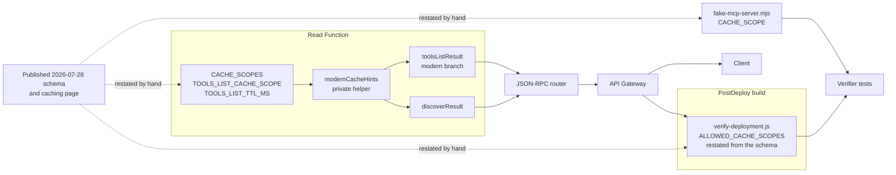
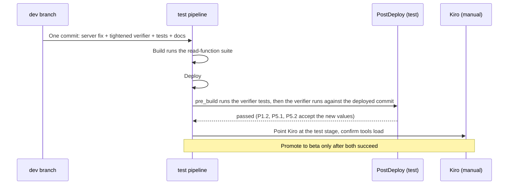

# Design Document

## Overview

This design makes the modern `tools/list` and `server/discover` results carry `cacheScope: "public"` and a `ttlMs`, both taken from one definition in `utils/mcp-protocol.js`. It tightens the post-deploy verifier so that an invalid scope fails the PostDeploy stage, and it corrects every test, document, script, and spec that states or asserts `"server"`. The server change is a few lines in one module. Most of the work is the tests and the guard around it.

[requirements.md](requirements.md) says what must be true. [PLAN.md](PLAN.md) holds the evidence and the locked decisions (Q1 to Q9). This document says exactly what changes in each file, how it is verified, and in what order.

### Design principles

1. **One definition per value, and no literal in a formatter.** `TOOLS_LIST_CACHE_SCOPE` and `CACHE_SCOPES` are written once. Both formatters get the cache hints from one private helper, so a change moves `tools/list` and `server/discover` together.
2. **The guard must not share the server's reading of the specification.** The verifier and its fake server restate the allowed values themselves and import nothing from Lambda code. If the server's reading is wrong again, the guard still has the specification's reading.
3. **Tests assert membership and equality to the constant, never a hard-coded string.** The old tests pinned `'server'`, which is how the defect passed.
4. **Fail in CI first, in the pipeline second, in front of a user last.** An architecture test blocks a literal, unit tests block an invalid constant, the verifier blocks an invalid deployed value, and a manual Kiro connection on `test` is the check against an independent validator.
5. **No infrastructure change.** The verifier runs inside the PostDeploy build that already exists.

### What is not designed here

Validating results against a copy of the published schema is the separate issue `0-0-7-schema-validation-of-modern-results`. No `P1.6` sub-check, no change to the request budget, no change to the TTL, and no operator-configurable scope (Requirement 14).

## Architecture

### Where the value is defined, used, and independently restated



The two dotted arrows into the Read Function and the verifier are deliberate. A shared constant would make the verifier agree with the server whether or not either agrees with the specification.

### Rollout order



The server and the verifier ship in one commit, and the PostDeploy build checks out the deployed commit (memory `upstream-pipeline-postdeploy-stage-facts`). The tightened verifier therefore never runs against a server older than itself in the pipeline. Running it by hand against a stage that is still on the previous build fails P1.2 and P5.1/P5.2 with the observed value in the reason, which is the intended signal.

## Components and edits

All paths are relative to the repository root. `RF` below means `application-infrastructure/src/lambda/read-function`.

### 1. Cache scope definition (Requirement 1)

File: `RF/utils/mcp-protocol.js`.

Add the two constants directly after `TOOLS_LIST_TTL_MS`, and widen the TTL's comment to say it also applies to `server/discover`:

```javascript
/**
 * Advisory TTL for tools/list and server/discover results in milliseconds.
 * (existing text unchanged, then:)
 * The same value applies to both results: the discover result changes only
 * on deploy, so it is cached for the same interval.
 *
 * Requirements: 7.3
 *
 * @constant {number}
 */
const TOOLS_LIST_TTL_MS = 10 * 60 * 1000; // 10 minutes

/**
 * Cache scopes the MCP 2026-07-28 specification allows on a cacheable result.
 * Any other value makes a validating client reject the result and fail to
 * connect.
 *
 * @see https://modelcontextprotocol.io/specification/2026-07-28/server/utilities/caching
 * @constant {ReadonlyArray<string>}
 */
const CACHE_SCOPES = Object.freeze(['public', 'private']);

/**
 * Cache scope of the modern tools/list and server/discover results.
 *
 * "public" is correct because neither result varies by caller: the tool
 * catalog is built without a tier or authentication parameter (see
 * buildToolCatalog in utils/tool-catalog.js), and the discover content is
 * the same for everyone.
 *
 * >! "public" lets a shared cache or gateway serve the result across
 * >! authorization contexts. If the catalog is ever filtered per tier or
 * >! personalized per caller, change this to "private" in the same change,
 * >! or the cache can hand one caller's list to another.
 *
 * Not operator-configurable on purpose: a bad value here is the exact
 * failure this constant exists to prevent.
 *
 * @constant {string}
 */
const TOOLS_LIST_CACHE_SCOPE = 'public';
```

Export both next to `TOOLS_LIST_TTL_MS`:

```javascript
  TOOLS_LIST_TTL_MS,
  CACHE_SCOPES,
  TOOLS_LIST_CACHE_SCOPE,
```

**Rejected: a module-load assertion that `TOOLS_LIST_CACHE_SCOPE` is in `CACHE_SCOPES`.** A thrown error at load would fail every cold start of the Read Function over a constant a unit test already checks in CI. A silent invalid value is worse than a failed build, but a failed deployment of a working function is worse than either.

### 2. Formatters (Requirements 2, 3, 4)

File: `RF/utils/mcp-protocol.js`.

One private helper builds the hints. It sits above `toolsListResult` and is not exported:

```javascript
/**
 * Cache hints of a modern cacheable result. Both tools/list and server/discover
 * read the hints from here, so one change moves both.
 *
 * @private
 * @returns {{ttlMs: number, cacheScope: string}} Fresh object on every call
 */
function modernCacheHints() {
  return { ttlMs: TOOLS_LIST_TTL_MS, cacheScope: TOOLS_LIST_CACHE_SCOPE };
}
```

`toolsListResult` (modern branch) replaces its two literals with a spread. Member order on the wire is unchanged (`tools`, `ttlMs`, `cacheScope`, `resultType`, `_meta`):

```javascript
    return jsonRpcSuccess(id, {
      tools: catalog,
      ...modernCacheHints(),
      resultType: 'complete',
      _meta: {
        'io.modelcontextprotocol/serverInfo': caps.serverInfo
      }
    });
```

`discoverResult` adds the same spread after `instructions`:

```javascript
  return jsonRpcSuccess(id, {
    supportedVersions: caps.supportedVersions,
    capabilities: caps.capabilities,
    instructions: caps.instructions,
    ...modernCacheHints(),
    resultType: 'complete',
    _meta: {
      'io.modelcontextprotocol/serverInfo': caps.serverInfo
    }
  });
```

JSDoc edits:

| Location | Before | After |
|----------|--------|-------|
| `toolsListResult` bullet list (line 241) | `cacheScope: 'server' (tools are server-scoped)` | `cacheScope: 'public' (the catalog is identical for every caller)` |
| `toolsListResult` example (line 265) | `cacheScope: 'server',` | `cacheScope: 'public',` |
| `discoverResult` `@returns` list | five members | adds `ttlMs: Advisory cache TTL` and `cacheScope: 'public'` |
| `discoverResult` example | five members | adds `ttlMs: 600000,` and `cacheScope: 'public',` after `instructions` |

The `discoverResult` comment gains one sentence: the content is identical for every caller and changes only on deploy, which is why `"public"` and the shared TTL apply (Requirement 3.4).

Untouched, with the reason (Requirement 4): the legacy branch of `toolsListResult`, `initializeResult`, `toolsCallResult` (no cache fields in the schema), `getCapabilities`, and the router. The router already routes `server/discover` to `discoverResult(id)` (`json-rpc-router.js:294-298`), so no router edit is needed.

### 3. Tool catalog cross-reference (Requirement 6)

File: `RF/utils/tool-catalog.js`. Item 4 of the `buildToolCatalog` comment (lines 156-158) gains a sentence. Comment only:

```javascript
 * 4. No tier-based filtering is applied or available — every manifest tool
 *    is always present in the output (Requirement 2.8). This function
 *    intentionally has no tier/auth parameter.
 *    >! That is what makes TOOLS_LIST_CACHE_SCOPE ("public") in
 *    >! utils/mcp-protocol.js correct. If a tier or caller filter is ever
 *    >! added here, change that constant to "private" in the same change.
```

### 4. Read Function tests (Requirement 5)

All Jest `*.test.js`, in the existing locations. Paths below are under `RF/tests`.

| File | Change |
|------|--------|
| `unit/utils/mcp-protocol-constants.test.js` | New `describe('CACHE_SCOPES and TOOLS_LIST_CACHE_SCOPE')`: `CACHE_SCOPES` is frozen and `[...CACHE_SCOPES].sort()` equals `['private', 'public']`; `TOOLS_LIST_CACHE_SCOPE` is a member; the modern `toolsListResult` and `discoverResult` report the same `cacheScope` and `ttlMs` as the constants (single source) |
| `unit/utils/mcp-protocol-discover.test.js` | The "exactly five keys" test becomes "exactly seven keys" with `_meta`, `cacheScope`, `capabilities`, `instructions`, `resultType`, `supportedVersions`, `ttlMs`. New tests: `ttlMs` is a non-negative integer equal to `TOOLS_LIST_TTL_MS`; `cacheScope` is in `CACHE_SCOPES` and equals `TOOLS_LIST_CACHE_SCOPE` |
| `integration/mcp-protocol-modern-required-fields.test.js` L80 | `expect(body.result.cacheScope).toBe('server')` becomes `expect(CACHE_SCOPES).toContain(body.result.cacheScope)` and `expect(body.result.cacheScope).toBe(TOOLS_LIST_CACHE_SCOPE)`. The three legacy cases (L118-122, L155-159, L189-193) already assert that `ttlMs` and `cacheScope` are absent for `2025-11-25`, `2024-11-05`, and no revision; they stay as they are (Requirement 5.5) |
| `unit/utils/json-rpc-router-server-discover.test.js` | New test: a modern `server/discover` request through `handleJsonRpc` returns `ttlMs` and `cacheScope` in the allowed set (Requirement 5.4) |
| `unit/architecture/no-hardcoded-cache-scope.test.js` | New, below |

The import in the integration and unit files gains `CACHE_SCOPES` and `TOOLS_LIST_CACHE_SCOPE` from `utils/mcp-protocol`.

#### The architecture test

It follows `no-hardcoded-revisions.test.js` (CommonJS, `'use strict'`, `>!` comments, a self-check of the detector). It reads files only and spawns nothing.

```javascript
'use strict';

const { describe, it, expect } = require('@jest/globals');
const fs = require('fs');
const path = require('path');

const LAMBDA_ROOT = path.join(__dirname, '../../..');

// >! A cacheScope property assigned a string literal. Comments are stripped first,
// >! so JSDoc examples may show the value. Quoted keys are covered too.
const SCOPE_LITERAL = /\bcacheScope['"`]?\s*:\s*['"`]/;

/**
 * Remove block comments and whole-line or trailing // comments, keeping every
 * line break so that line numbers still match the file.
 *
 * @param {string} source - JavaScript source
 * @returns {string} Source without comments
 */
function stripComments(source) {
  return source
    .replace(/\/\*[\s\S]*?\*\//g, (block) => block.replace(/[^\n]/g, ''))
    .replace(/(^|\s)\/\/.*$/gm, '$1');
}

/**
 * List the .js files under a directory, skipping node_modules, tests, and coverage.
 *
 * @param {string} dir - Directory to walk
 * @returns {string[]} Absolute file paths
 */
function sourceFiles(dir) {
  const files = [];
  for (const entry of fs.readdirSync(dir, { withFileTypes: true })) {
    const full = path.join(dir, entry.name);
    if (entry.isDirectory()) {
      if (!['node_modules', 'tests', 'coverage'].includes(entry.name)) {
        files.push(...sourceFiles(full));
      }
    } else if (entry.name.endsWith('.js')) {
      files.push(full);
    }
  }
  return files;
}

describe('Architecture: no hardcoded cacheScope', () => {
  it('assigns no string literal to cacheScope in executable code', () => {
    const violations = [];
    for (const file of sourceFiles(LAMBDA_ROOT)) {
      stripComments(fs.readFileSync(file, 'utf8')).split('\n').forEach((line, index) => {
        if (SCOPE_LITERAL.test(line)) {
          violations.push(`${path.relative(LAMBDA_ROOT, file)}:${index + 1}  ${line.trim()}`);
        }
      });
    }
    expect(violations).toEqual([]);
  });

  it('detects literals and ignores constants, spreads, and comments', () => {
    const cases = [
      { code: "cacheScope: 'server'", matches: true },
      { code: '"cacheScope": "public"', matches: true },
      { code: 'cacheScope: TOOLS_LIST_CACHE_SCOPE', matches: false },
      { code: '...modernCacheHints()', matches: false },
      { code: "// cacheScope: 'public'", matches: false }
    ];
    for (const { code, matches } of cases) {
      expect(SCOPE_LITERAL.test(stripComments(code))).toBe(matches);
    }
  });
});
```


### 5. Post-deploy verifier (Requirement 7)

File: `application-infrastructure/postdeploy-scripts/verify-deployment.js`. The sub-check catalog (`SUB_CHECK_ROWS`), the report, and the request builders do not change.

**Constant**, in the Constants section beside `SERVER_NAME`:

```javascript
/**
 * Values the MCP 2026-07-28 schema allows for `cacheScope` on a cacheable result.
 *
 * >! Restated here from the published schema on purpose. The verifier must not read
 * >! the server's own definition: a check that shares the server's reading of the
 * >! specification cannot catch the server misreading it.
 *
 * @see https://modelcontextprotocol.io/specification/2026-07-28/server/utilities/caching
 * @type {ReadonlyArray<string>}
 */
const ALLOWED_CACHE_SCOPES = Object.freeze(['public', 'private']);
```

**Shared judgment**, beside `judgeModernToolsList`. P1.2 and P5.1/P5.2 both call it, so the two results are judged by one rule:

```javascript
/**
 * Describe why a modern result's cache hints are invalid, or return null.
 *
 * Asserts shape only: `ttlMs` is a non-negative integer and `cacheScope` is one of the
 * values the specification allows. The `ttlMs` duration and which allowed scope the
 * server chose are configured values and are never compared (Requirement 7.9 of the
 * smoke spec).
 *
 * @private
 * @param {Object} result - A modern JSON-RPC result
 * @param {Array.<*>} secrets - Values to redact
 * @returns {(string|null)} The failure reason, or null when the hints are valid
 * @example
 * cacheHintsProblem({ ttlMs: 600000, cacheScope: 'server' }, []);
 * // 'result.cacheScope is "server", expected "public" or "private"'
 */
function cacheHintsProblem(result, secrets) {
  if (!Number.isInteger(result.ttlMs) || result.ttlMs < 0) {
    return `result.ttlMs is ${formatValue(result.ttlMs, secrets)}, expected a non-negative integer`;
  }
  if (!ALLOWED_CACHE_SCOPES.includes(result.cacheScope)) {
    const allowed = ALLOWED_CACHE_SCOPES.map((scope) => JSON.stringify(scope)).join(' or ');
    return `result.cacheScope is ${formatValue(result.cacheScope, secrets)}, expected ${allowed}`;
  }
  return null;
}
```

**`judgeModernToolsList`** replaces its `ttlMs` and `cacheScope` blocks (L2816-2822) with:

```javascript
  const hintsProblem = cacheHintsProblem(result, secrets);
  if (hintsProblem !== null) {
    return failVerdict(hintsProblem);
  }
```

The order of its checks is unchanged: `resultType`, cache hints, server name, tools array.

**P1.2** (L2207) calls the same function after the `resultType` check and before the handshake-key check:

```javascript
  ctx.evaluate('P1.2', [p1], withResult((current) => {
    if (current.resultType !== 'complete') {
      return failVerdict(`result.resultType is ${formatValue(current.resultType, secrets)}, expected "complete"`);
    }
    // >! server/discover is a cacheable result: the schema requires ttlMs and a valid cacheScope
    const hintsProblem = cacheHintsProblem(current, secrets);
    if (hintsProblem !== null) {
      return failVerdict(hintsProblem);
    }
    // >! The modern envelope has no handshake fields; either one means the legacy shape leaked in
    for (const key of ['protocolVersion', 'serverInfo']) { /* unchanged */ }
    return { ok: true };
  }));
```

**Comment updates.** The text "a non-empty string `cacheScope`" appears in the `checkP5` header (L3008) and in the failure message being replaced. The `judgeModernToolsList` JSDoc, the `checkP1` JSDoc ("Records P1.1 to P1.5"), and the `checkP5` JSDoc say instead that `cacheScope` is `public` or `private`, and the `checkP1` JSDoc adds that P1.2 also requires `ttlMs` and `cacheScope`. After the edit, `grep -n "non-empty string" verify-deployment.js` shows only the `instructions` check (Requirement 7.7).

**Reasons.** Existing style: `result.<field> is <value>, expected <rule>`, JSON-encoded, redacted, cut to 80 characters.

| Sub-check | Condition | Reason |
|-----------|-----------|--------|
| P1.2, P5.1, P5.2 | `ttlMs` missing or negative or not an integer | `result.ttlMs is undefined, expected a non-negative integer` |
| P1.2, P5.1, P5.2 | `cacheScope` not `"public"` or `"private"` | `result.cacheScope is "server", expected "public" or "private"` |
| P5.3 to P5.5 | A legacy answer carries `ttlMs` or `cacheScope` | Unchanged: `result has unexpected key "ttlMs"` |

The verifier remains dependency-free CommonJS, sends the same requests in the same order, and its 45 sub-check IDs and the 36 core and 9 advisory split do not change (Requirement 7.5).

### 6. Fake server and verifier tests (Requirement 8)

Paths are under `application-infrastructure/tests/postdeploy-verify`.

**`helpers/fake-mcp-server.mjs`.** Define the scope next to the TTL, with its own comment citing the schema, and use it in both answers:

```javascript
/** Advisory TTL the modeled server reports on tools/list and server/discover. */
export const TOOLS_LIST_TTL_MS = 10 * 60 * 1000;

/**
 * The `cacheScope` a conformant server may report. Written here from the
 * published 2026-07-28 schema, not imported from the Read Function.
 */
export const CACHE_SCOPE = 'public';
```

- L691: `cacheScope: 'server'` becomes `cacheScope: CACHE_SCOPE`.
- The `server/discover` answer (L677-684) gains `ttlMs: TOOLS_LIST_TTL_MS, cacheScope: CACHE_SCOPE` after `instructions`.

**`fake-mcp-server-tests.jest.mjs`.** L267 and L277: `expect(json.result.cacheScope).toBe('server')` becomes `.toBe('public')`. The discover test (L163-175) adds `expect(json.result.ttlMs).toBe(600000)` and `expect(json.result.cacheScope).toBe('public')`. The assertions use literals on purpose: the fake models the specification, and the test says so.

**`checks-tests.jest.mjs`.** New `FAILURES` rows, in table order, each asserted by the existing harness (the documented reason matches and only the intended sub-check fails). The existing coverage test (L782) already requires that every sub-check has at least one failure row.

| Row id | Name | Mutation | Reason pattern |
|--------|------|----------|----------------|
| `P1.2` | server/discover has a cacheScope the specification does not allow | `REQ.P1`: `body.result.cacheScope = 'server'` | `/^result\.cacheScope is "server", expected "public" or "private"$/` |
| `P1.2` | server/discover has no ttlMs | `REQ.P1`: `delete body.result.ttlMs` | `/^result\.ttlMs is undefined, expected a non-negative integer$/` |
| `P5.1` | the modern tools/list has cacheScope "server" | `REQ.P5a`: `body.result.cacheScope = 'server'` | the `"server"` pattern above |
| `P5.2` | the modern tools/list (params._meta) has cacheScope "server" | `REQ.P5b`: `body.result.cacheScope = 'server'` | the `"server"` pattern above |
| `P5.2` | (existing row) empty cacheScope | unchanged | `/^result\.cacheScope is "", expected "public" or "private"$/` |

`outcome-and-report-tests.jest.mjs` (the 45 pinned IDs) and the budget tests are not edited, and must pass unchanged. That is the check that no ID or request count moved.

### 7. Smoke spec text (Requirement 9)

Paths are under `.kiro/specs/0-0-7-postdeploy-smoke-verification`. `tasks.md` is not edited.

| File and line | Before | After |
|---------------|--------|-------|
| `requirements.md` L123 (4.2) | `... \`resultType\` equal to \`complete\`, \`_meta[...].name\` equal to ...` | inserts after `resultType` equal to `complete`: "a non-negative integer `ttlMs`, a `cacheScope` equal to `public` or `private`," |
| `requirements.md` L164 (7.2) | `a non-empty string \`cacheScope\`` | `a \`cacheScope\` equal to \`public\` or \`private\`` |
| `design.md` P1.2 row (L477) | `` `resultType` is `complete`, and there is no top-level `protocolVersion` or `serverInfo` `` | `` `resultType` is `complete`, `ttlMs` is a non-negative integer, `cacheScope` is `public` or `private`, and there is no top-level `protocolVersion` or `serverInfo` `` |
| `design.md` P5.1 row (L502) | `` `cacheScope` is a non-empty string `` | `` `cacheScope` is `public` or `private` `` |

The P5.2 row says "The same" and needs no edit. Searching both files for `non-empty string` should leave only the `instructions` mentions.

### 8. Dual-era spec history (Requirement 10)

Paths are under `.kiro/specs/0-0-7-mcp-protocol-dual-era`. `tasks.md` and `requirements.md` are not edited.

**`design.md`:**

| Line | Edit |
|------|------|
| 436 | `cacheScope: 'server',   // Requirement 7.3` becomes `cacheScope: TOOLS_LIST_CACHE_SCOPE,   // Requirement 7.3 ('public')` |
| 457 | Rewritten: "`cacheScope: 'public'` means the response may be served from a shared cache across callers, which is true for this stateless, authentication-independent tool manifest ([caching](https://modelcontextprotocol.io/specification/2026-07-28/server/utilities/caching)). (The optional discovery-spec filters do not vary tools/list output; they vary `search_documentation` output.)" followed by a note line: "> **Correction, 2026-10-29**: this design first specified `'server'`, which the specification does not allow. See [0-0-7-tools-list-returns-cachescope-server-which-kiro](../0-0-7-tools-list-returns-cachescope-server-which-kiro/)." |
| 458 | "Both TTL and scope come from this file-level constant and object literal" becomes "Both TTL and scope come from the file-level constants `TOOLS_LIST_TTL_MS` and `TOOLS_LIST_CACHE_SCOPE`" |
| 716 | `cacheScope: 'server';` becomes `cacheScope: 'public' \| 'private';   // this server emits 'public'` |
| 874 | `cacheScope: 'server'` becomes `cacheScope: 'public'` (inside the quoted CHANGELOG draft) |
| 411-420 | The `discoverResult` example gains `ttlMs: TOOLS_LIST_TTL_MS,` and `cacheScope: TOOLS_LIST_CACHE_SCOPE,` before `resultType` |
| 685-695 | The `DiscoverResult` interface gains `ttlMs: number;` and `cacheScope: 'public' \| 'private';` |

**`TODO-MANUAL-VERIFY.md`:**

- L369 becomes `printf '%s' "$M" | check "cacheScope is public"   '.result.cacheScope == "public"'`.
- Section C1 (L247-254) gains two checks after the `resultType` line:

```bash
printf '%s' "$D" | check "ttlMs is 600000"        '.result.ttlMs == 600000'
printf '%s' "$D" | check "cacheScope is public"   '.result.cacheScope == "public"'
```

The manual script asserts the exact `"public"`, unlike the verifier, because it is a human cross-check of this deployment's intended value, not a guard that must survive a deliberate change to `"private"`.

### 9. Documentation (Requirement 11)

| File | Edit |
|------|------|
| `ARCHITECTURE.md` L454 | `server/discover` modern column becomes `supportedVersions`, `capabilities`, `instructions`, `ttlMs`, `cacheScope`, `resultType`, `_meta` |
| `ARCHITECTURE.md` L457 | The paragraph ends: "`ttlMs` (10 minutes) and `cacheScope` (`"public"`) on `tools/list` and `server/discover` are advisory for the client. Both results are identical for every caller, so a shared cache may reuse them. The Lambda does not cache `tools/list` itself." |
| `docs/end-user/supported-protocol-revisions.md` L108 | "`ttlMs` and `cacheScope` on `tools/list` and `server/discover`: the result can be cached by the client for `600000` ms (10 minutes), and it is the same for every client (`"public"`)." |
| `docs/developer/gradual-deployment.md` L97 | `cacheScope: "server"` becomes `cacheScope: "public"` |
| `docs/developer/mcp-protocol-sources.md` L17 | The row becomes: `Modern cache hint on \`tools/list\` and \`server/discover\` \| \`TOOLS_LIST_TTL_MS\`, \`TOOLS_LIST_CACHE_SCOPE\`, and the allowed set \`CACHE_SCOPES\` in \`utils/mcp-protocol.js\` \| The formatters`. |
| `docs/developer/mcp-protocol-sources.md` L22 onward | "Three tests enforce" becomes "Four tests enforce", with a new bullet: "`tests/unit/architecture/no-hardcoded-cache-scope.test.js` fails if executable code assigns a string literal to `cacheScope`." A short paragraph follows: the verifier and its fake server restate the allowed scopes from the specification on purpose and do not import this definition |
| `docs/admin-ops/post-deploy-verification.md` L22, L27 | P1 row adds "has the `ttlMs` and `cacheScope` the schema requires on a discover result". P5 row: "`ttlMs`, `cacheScope`" in the list of fields stays; add that `cacheScope` must be `public` or `private` |
| `docs/developer/post-deploy-verification.md` L23, L28 | P1 and P5 rows say the same |

The documentation does not describe the scope as configurable, and none of the pages' counts change (45, 36, 9). All fences keep their language tags.

### 10. Changelog (Requirement 12)

File: `CHANGELOG.md`, under `[v0.0.7] (unreleased)`.

**In-place edit (Q5, the one edit to existing text).** In the Added bullet of MCP Protocol Dual-Era Support (L29), change only the value: `` `cacheScope: "server"` `` becomes `` `cacheScope: "public"` ``.

**New entry** at the end of the unreleased **Fixed** list, in the format of its neighbours:

```markdown
- **`tools/list` returned a `cacheScope` the specification does not allow, so Kiro could not connect** [Spec: 0-0-7-tools-list-returns-cachescope-server-which-kiro](../.kiro/specs/0-0-7-tools-list-returns-cachescope-server-which-kiro/) ([#7](https://github.com/63Klabs/atlantis-mcp/issues/7)) - The modern-era (`2026-07-28`) `tools/list` result carried `cacheScope: "server"`; the specification allows only `"public"` or `"private"`, so clients that validate results rejected it and failed to connect. It now returns `"public"`, because the tool list is identical for every caller
  - `server/discover` now also carries the `ttlMs` (10 minutes) and `cacheScope` (`"public"`) that its schema requires
  - The scope and its allowed set are code constants (`TOOLS_LIST_CACHE_SCOPE`, `CACHE_SCOPES`) in `utils/mcp-protocol.js`, not a setting. If the tool list is ever filtered per tier, the scope must become `"private"`
  - The post-deploy verifier now requires `cacheScope` to be `public` or `private` on `tools/list` and `server/discover`, and `ttlMs` to be a non-negative integer on `server/discover`, so a wrong value fails the PostDeploy stage. The sub-check IDs and counts are unchanged
  - Legacy-era results (`2024-11-05`, `2025-11-25`, no declared revision) are unchanged
```

The Post-Deploy Smoke Verification bullet is not edited.

## Verification design

### V-A: Tests (Requirements 5, 8, 13.1)

Run the narrow files first, then the suites. Per the test-execution rules, the commands call Jest directly and no test runs `npm test`.

```bash
# Check for stray test processes before starting
ps aux | grep -E "jest" | grep -v grep

# Read Function: the files this change touches, then the whole suite
cd application-infrastructure/src/lambda/read-function
timeout 300s npx jest tests/unit/utils/mcp-protocol-constants.test.js tests/unit/utils/mcp-protocol-discover.test.js tests/unit/utils/json-rpc-router-server-discover.test.js tests/integration/mcp-protocol-modern-required-fields.test.js tests/unit/architecture/no-hardcoded-cache-scope.test.js
timeout 900s npx jest

# Verifier package (its test script calls the Jest binary directly)
cd ../../../tests/postdeploy-verify
timeout 600s npm test
```

If the verifier package has no `node_modules`, `npm ci --include=dev` installs the pinned set first, as the post-deploy `pre_build` phase does.

### V-B: Red-green checks (not committed)

Each is done once, by hand, and reverted.

1. **Read Function.** Set `TOOLS_LIST_CACHE_SCOPE` to `'server'`. Expected: the constants test and the discover and integration tests fail on the membership and key-set assertions. Revert.
2. **Architecture test.** Put `cacheScope: 'public'` back into `toolsListResult`. Expected: `no-hardcoded-cache-scope` fails and names the file. Revert.
3. **Verifier against the old defect.** Before editing the verifier, change only the fake to `'server'` and run the verifier tests: the healthy-run tests pass, which shows the old gap. After editing the verifier, the same fake change makes the healthy-run tests fail on P1.2, P5.1, and P5.2 with the documented reasons. Revert the fake to `'public'`.

### V-C: Real server against the real verifier, locally (optional, not committed)

The verifier tests prove it against a fake. This check proves the real formatters satisfy the real verifier before anything is deployed. Plain `node` cannot load the router (memory `test-running-and-postdeploy-test-gotchas`), so a temporary `tests/unit/*.tmp.test.js` serves `handleJsonRpc` from `http.createServer` on `127.0.0.1` until a stop file appears, started in the background and writing output to a file under `/tmp`. The verifier accepts `http:` for `127.0.0.1`.

```bash
# MCP_URL points at the temporary stand-in; EXPECTED_VERSION is the first CHANGELOG version
MCP_URL=http://127.0.0.1:3999/mcp/v1 EXPECTED_VERSION=0.0.7 \
  VERIFY_REPORT_PATH=/tmp/verify-report.json \
  node application-infrastructure/postdeploy-scripts/verify-deployment.js
```

Judge only P1 to P6 and V1: the stand-in has no authentication, CORS, or backends, so S1, X1, and T1 are expected to fail or be skipped there. Delete the temporary test and stop the server when done.

### V-D: Deployed stage (Requirement 13)

Q7 is A: no probe of the deployed stage before the fix is deployed.

1. Deploy to `test` through the normal flow. The Build stage runs the Read Function suite. The PostDeploy stage runs the verifier tests in `pre_build` and then the verifier against the deployed commit. Record the PostDeploy outcome (`passed`) from its log or the `VERIFY_REPORT` line.
2. Point Kiro at the `test` stage and confirm that the tools load. If they do not, capture the Kiro MCP log, which is the only place a client-side validation error is visible.
3. Optionally run the corrected F1 and C1 blocks of the manual script against `test` as a cross-check.
4. Do not promote to `beta` until 1 and 2 are met.

A passing PostDeploy proves the result has the shape the specification describes. It does not prove that a particular client accepts it, which is why step 2 is separate.

## Error handling and rollback of the change itself

- **A wrong value on a stage.** The PostDeploy stage fails with the observed value in the reason. The failed stage is retried by a person after the new build is deployed, or the commit is reverted through the pipeline (memory `upstream-pipeline-postdeploy-stage-facts`). Nothing retries automatically.
- **Verifier false positive.** If a future revision legitimately adds a scope, `ALLOWED_CACHE_SCOPES` and the fake's `CACHE_SCOPE` need a deliberate edit, and the failure reason makes that obvious. The skip switch (`Mcp_PostDeployTestVerifySkip`) exists for an urgent deploy.
- **Revert.** The change is a code-only, in-place Lambda update. Reverting the commit restores `"server"`, which re-breaks the Kiro connection but changes nothing else. Legacy clients are unaffected in either direction.
- **Clients holding a cached result.** No client can hold a cached `"server"` result: a validating client rejected it, and a non-validating one never cached by scope. A client that caches the new `"public"` result keeps it for up to 10 minutes. During a PROD gradual shift, two versions serve traffic for about 30 minutes, which is already documented in `docs/developer/gradual-deployment.md` and does not change here.

## Security considerations

- **`"public"` is a statement about confidentiality.** A shared cache or gateway may serve a public result across authorization contexts. It is correct today because the catalog and the discover content do not vary by caller, and it is written down next to the constant and next to the code that would break it (Requirements 1.3 and 6).
- **The scope is not operator-settable.** An environment variable could emit an invalid value or flip to `"public"` without review.
- **The scope is not an access control.** The specification says servers must not rely on `cacheScope` for authorization, and nothing here does.
- **The verifier's independence is a control.** Restating the allowed values from the specification is what lets it catch the server's misreading. The comment says so.
- **Secrets and logs.** No new secret is read or logged. The verifier's reasons go through the existing redaction and 80-character cut, and the new reasons contain only a field name, the value the server returned, and the allowed values.
- **No new permission or dependency.** No IAM, KMS, parameter, or package changes.

## Requirement traceability

| Requirement | Design section |
|-------------|----------------|
| 1 Single definition | 1, 4 (architecture test), 9 (sources page) |
| 2 `tools/list` | 2 |
| 3 `server/discover` | 2 |
| 4 Unchanged results | 2 (untouched list), 4 (legacy cases kept) |
| 5 Read Function tests | 4 |
| 6 Tool catalog cross-reference | 3 |
| 7 Verifier | 5 |
| 8 Fake server and tests | 6 |
| 9 Smoke spec text | 7 |
| 10 Dual-era history | 8 |
| 11 Documentation | 9 |
| 12 Changelog | 10 |
| 13 Verification and rollout | Rollout order, V-A to V-D |
| 14 Scope boundaries | "What is not designed here", V-D |

## Implementation order

1. Protocol Module constants, helper, and both formatters (sections 1 and 2); the tool-catalog comment (section 3).
2. Read Function tests (section 4). Run V-A for the Read Function and V-B 1 and 2.
3. Fake server and its tests (section 6, fake part only), then the verifier (section 5), then the new failure rows. Do V-B 3 in this order: fake first, observe the old verifier pass, then tighten the verifier.
4. Optional V-C against the real router.
5. Smoke spec and dual-era text, the manual script, and the documentation (sections 7, 8, 9).
6. Changelog (section 10).
7. Run the full suites (V-A). Search the working tree for remaining `cacheScope: "server"` and `'server'` mentions outside this spec's own documents and the untouched histories.
8. Leave the commit to the owner. Deploy to `test` and run V-D.

## Open points carried into implementation

- **Line numbers.** Those cited above were read on 2026-10-29 at `dev` `65bf343` plus uncommitted spec files. Re-find each by text, not by number, when editing.
- **Exact wording of the end-user and ARCHITECTURE paragraphs** is given as target text. Adjust only to fit the surrounding sentences.
- **Whether the V-C stand-in is worth setting up** is the implementer's call. V-A and V-D already cover the verifier against a fake and against the deployed stage; V-C adds the real formatters against the real verifier before deploy.
